<!-- Generated by spec-lite | agent: plan | date: 2026-10-13 | revised: 2026-10-15 | converted to spec-lite format: 2026-10-15 -->
<!-- Generated by spec-lite | agent: plan | date: 2026-10-13 | revised: 2026-10-15 | converted to spec-lite format: 2026-10-15 -->

# Plan: Reliable Completion of `yantra do` Tasks

## 1. Overview

Run `20261014T023539Z-do-7039cbaa` asked `yantra do` to fill suitable test data into every field of a supplied test form, then take a screenshot without submitting. This is a reasonable medium-complexity browser task. The run lasted 13m 04s. It committed 10 of at least 40 controls and captured no screenshot. Still, the manifest said `completed`, the terminal printed `Published Brief: <path>`, and the CLI exited 0.

**The finding.** The failure was a chain of missing information and misleading feedback, followed by time exhaustion. The model saw a truncated page and was not told. Every visible control was unnamed, so a ref was effectively a position among blank textboxes. Not-found feedback offered navigation links instead of fields. The screenshot and the no-submit constraint lived only in free-text contract `notes`. A masked control reported a false commit failure. Plain text fills took about five seconds each. No screenshot tool was registered. And publishing a Brief was read as completing the task. [§5 Evidence](#5-evidence) has the full diagnosis.

**The goal.** For an ordinary form, the model chooses values and a small number of actions. The engine does the rest:

- supplies the complete inventory and field identities;
- resolves and verifies controls;
- enforces declared effects, such as no submission;
- accounts for progress against contract items;
- persists the requested capture.

A saved partial Brief stays useful, but task success means every declared contract item was fulfilled, judged from evidence.

**Scope.** Seven vertical slices, FEAT-054 to FEAT-060. Each one ships behavior, meaningful tests, artifact compatibility, and relevant user documentation.

**Not in this plan.** Multi-step (wizard) forms, a zero-LLM `capture` workflow verb, an attended inline grant prompt, and a terminal heartbeat during long provider turns. All four are in TODO ([§15](#15-related-todo-entries)). The plan adds no site-specific logic, no unrestricted scripts, no raw-HTML export, no `view-source:` bypass, no larger global budgets, and no replacement agent SDK.

**Sources.** [Focused run review](reviews/review_do_workflow_run_20261014.md) and [plan critique](reviews/plan_critique_do_workflow_reliability.md). This revision resolves both blocking findings and all six important findings; see the [revision log](#16-revision-log).

# Plan: Reliable Completion of `yantra do` Tasks

## 1. Overview

Run `20261014T023539Z-do-7039cbaa` asked `yantra do` to fill suitable test data into every field of a supplied test form, then take a screenshot without submitting. This is a reasonable medium-complexity browser task. The run lasted 13m 04s. It committed 10 of at least 40 controls and captured no screenshot. Still, the manifest said `completed`, the terminal printed `Published Brief: <path>`, and the CLI exited 0.

**The finding.** The failure was a chain of missing information and misleading feedback, followed by time exhaustion. The model saw a truncated page and was not told. Every visible control was unnamed, so a ref was effectively a position among blank textboxes. Not-found feedback offered navigation links instead of fields. The screenshot and the no-submit constraint lived only in free-text contract `notes`. A masked control reported a false commit failure. Plain text fills took about five seconds each. No screenshot tool was registered. And publishing a Brief was read as completing the task. [§5 Evidence](#5-evidence) has the full diagnosis.

**The goal.** For an ordinary form, the model chooses values and a small number of actions. The engine does the rest:

- supplies the complete inventory and field identities;
- resolves and verifies controls;
- enforces declared effects, such as no submission;
- accounts for progress against contract items;
- persists the requested capture.

A saved partial Brief stays useful, but task success means every declared contract item was fulfilled, judged from evidence.

**Scope.** Seven vertical slices, FEAT-054 to FEAT-060. Each one ships behavior, meaningful tests, artifact compatibility, and relevant user documentation.

**Not in this plan.** Multi-step (wizard) forms, a zero-LLM `capture` workflow verb, an attended inline grant prompt, and a terminal heartbeat during long provider turns. All four are in TODO ([§15](#15-related-todo-entries)). The plan adds no site-specific logic, no unrestricted scripts, no raw-HTML export, no `view-source:` bypass, no larger global budgets, and no replacement agent SDK.

**Sources.** [Focused run review](reviews/review_do_workflow_run_20261014.md) and [plan critique](reviews/plan_critique_do_workflow_reliability.md). This revision resolves both blocking findings and all six important findings; see the [revision log](#16-revision-log).

## 2. High-Level Features

| ID       | Feature                                                                                                                                                                                                                                                                                                                                                  | Spec File                                                        | Status          |
| -------- | -------------------------------------------------------------------------------------------------------------------------------------------------------------------------------------------------------------------------------------------------------------------------------------------------------------------------------------------------------- | ---------------------------------------------------------------- | --------------- |
| FEAT-054 | Contract Terms & Honest Task Outcome: additive action terms in the task contract (`deliverable: 'actions'`, `fill`, `artifacts`, `effects`); per-item fulfillment judged from evidence; one outcome vocabulary across commands (`fulfilled`/`partial`/`handoff`/`failed`/`aborted`); `CONTRACT_REQUIRED` on `do` publish; promotion gated on `fulfilled` | `features/FEAT-054-contract_terms_honest_outcome/spec.md`        | [x] Complete    |
| FEAT-055 | Complete Form Inventory & Field Identity: truncation totals and omitted counts with continuation (Part A); bounded form metadata through a shared core field-identity module used by observation, resolution, reacquisition, and replay (Part B); stable refs; fillable-control feedback                                                                 | `features/FEAT-055-complete_form_inventory/spec.md`              | [x] Complete    |
| FEAT-056 | Protected-Value Verification: a typed withheld state in place of an empty-string readback, a safe match verdict for caller-supplied data, failure classes that match what was observed, and withheld reasons in the inventory                                                                                                                            | `features/FEAT-056-protected_value_verification/spec.md`         | [x] Complete    |
| FEAT-057 | Plain-Field Fill Performance & Batch Clarity: a tighter `watch-and-select` entry in the declarative fill plan, a stated ten-field batch cap, shape-neutral prompt examples, and compact batch results with remaining counts                                                                                                                              | `features/FEAT-057-plain_field_fill_performance/spec.md`         | [/] In progress |
| FEAT-058 | Local Deliverable Capture: a `browser_capture` tool, separate from Vision Assist, that saves a clean PNG locally with no grant and no provider transmission; capability resolved before execution; early gap disclosure; a generic artifact reference                                                                                                    | `features/FEAT-058-local_deliverable_capture/spec.md`            | [ ] Not started |
| FEAT-059 | Contract-Item Progress: a runtime ledger of contract items in `run-health.json`, semantic stall detection at provider/tool boundaries, one bounded recovery steer, a provider-turn time limit, progress events, and per-turn reasoning telemetry                                                                                                         | `features/FEAT-059-contract_item_progress/spec.md`               | [ ] Not started |
| FEAT-060 | Action Evidence & Generality Benchmark: sanitized action and capture evidence citable from the Brief, browser mutation scenarios in the task-fidelity harness, and a live multi-model benchmark that closes the end-to-end acceptance gate                                                                                                               | `features/FEAT-060-action_evidence_generality_benchmark/spec.md` | [ ] Not started |

> **Note**: Plan assigns immutable IDs. FEAT-054 follows the maximum (FEAT-053) across every plan and feature directory. Row order is delivery order; [§8 Sequencing](#sequencing) states the permitted overlaps. **Feature** creates the listed spec; **Implement** alone marks `[/] In progress` and `[x] Complete`.

**Milestones**

| Milestone              | Features            | Exit demonstration                                                                                                                                                                                           |
| ---------------------- | ------------------- | ------------------------------------------------------------------------------------------------------------------------------------------------------------------------------------------------------------ |
| M1: Honest form fill   | FEAT-054 – FEAT-058 | A generic fixture that exceeds the model-visible cap is filled correctly, the screenshot is saved, and the outcome, terminal line, and exit code are all truthful. The deterministic layout matrix is green. |
| M2: Adaptive execution | FEAT-059            | Stalls are bounded and visible on form and non-form `do` tasks.                                                                                                                                              |
| M3: Acceptance gate    | FEAT-060            | The [§12 FEAT-060](#feat-060-attribute-actions-and-test-generality) acceptance gate passes, and the live benchmark is recorded in the revision log.                                                          |

## 3. Tech Stack Additions

**No additions — see memory.** Field identity, structural labels, submit-class classification, and capture all use the pinned Puppeteer/CDP surface and existing core modules. If a Feature agent considers a new dependency (for example, an image library for full-page tiling), it needs the user's approval first (memory → Dependencies).

## 4. Decisions

These decisions change what users see. Each follows the critique's recommendation, or is the smallest rule that makes it enforceable. **Status: recorded 2026-10-15. Override any of them before Feature planning starts.**

| ID  | Decision                                                                                                                                                                                                                                                                                                                      | Why                                                                                                                                                                                                       | Owner              |
| --- | ----------------------------------------------------------------------------------------------------------------------------------------------------------------------------------------------------------------------------------------------------------------------------------------------------------------------------- | --------------------------------------------------------------------------------------------------------------------------------------------------------------------------------------------------------- | ------------------ |
| D1  | The task contract gains additive, task-shape-neutral action terms: `deliverable: 'actions'`, `fill` coverage, `artifacts`, and `effects`. Fulfillment is evaluated per contract item from tool evidence.                                                                                                                      | The runtime cannot check a requirement that exists only as model prose in `notes`. In this run, the screenshot and the no-submit constraint lived only there.                                             | FEAT-054           |
| D2  | `context.screenshots` keeps one meaning: pixels sent to the model (Vision Assist). A deliverable capture saved only to the run directory needs no grant. It obeys the secret latch, owner-only file modes, its own capture budget, and audit listing. `--no-screenshots` suppresses both kinds of capture for one invocation. | The grant defaults to off, and the warning shown when it is set promises provider transmission. Reusing the grant would make that warning wrong and make "take a screenshot" fail on every fresh install. | FEAT-058           |
| D3  | Every command uses one task-outcome vocabulary: `fulfilled`, `partial`, `handoff`, and `failed`, plus the existing user `aborted`. The earlier `blocked` folds into the existing `handoff`.                                                                                                                                   | A second enum beside `AgenticTaskOutcome` would let five consumers diverge. Consistent CLI vocabulary is a product requirement.                                                                           | FEAT-054           |
| D4  | In `do`, `result_publish` requires a declared contract. Without one, it returns a typed `CONTRACT_REQUIRED` failure that names `task_contract` as the next move. A result salvaged without any contract is `partial`, with reason `contract_missing`.                                                                         | Otherwise a model could skip the contract and be judged against nothing. The failure names a move the engine supports, as memory requires of tool-result advice.                                          | FEAT-054           |
| D5  | `--save-as` saves a workflow only from a `fulfilled` run. If a fulfilled item has no replay step (today, a screenshot), the workflow is saved without that step and the terminal names the omission.                                                                                                                          | A partial trace must not become a workflow, and a saved workflow must not silently drop a requested deliverable.                                                                                          | FEAT-054, FEAT-055 |

## 5. Evidence

Run artifacts are in `~/.yantra/data/runs/20261014T023539Z-do-7039cbaa/`. The [focused review](reviews/review_do_workflow_run_20261014.md) holds the line-level evidence.

### Diagnosis

| #   | Gap                                                                                                                                                                                                                                                                                                                                                                                                                                                                                                                                                                                                                                                        | Fixed by           |
| --- | ---------------------------------------------------------------------------------------------------------------------------------------------------------------------------------------------------------------------------------------------------------------------------------------------------------------------------------------------------------------------------------------------------------------------------------------------------------------------------------------------------------------------------------------------------------------------------------------------------------------------------------------------------------- | ------------------ |
| G1  | **The model saw a truncated page and was not told.** The model-visible cap is 50 (`DEFAULT_INTERACTABLE_CAP`). The snapshot truncates in reading order with `ordered.slice(0, maxInteractables)` and reports no total or omitted count. Both observations returned exactly `e1`–`e50` and no buttons. The first fill failure's suggestions came from a wider resolution pass, which counted 58 named interactables against the 10 named entries the model saw. At least 48 interactables were therefore invisible, apparently including the form's own buttons. Whether more fields were cut is not established; either way, "every field" was unknowable. | FEAT-055 Part A    |
| G2  | **All 40 visible controls had empty names.** The page text contained the field labels, but nothing trustworthy connected a label to an actionable ref. Unnamed controls also receive the ref identity `role + '' + ordinal`, so a ref was effectively a position among blank textboxes. The agent spent many turns trying to reconstruct the mapping.                                                                                                                                                                                                                                                                                                      | FEAT-055 Part B    |
| G3  | **Name-based fill failed, and the feedback pointed the wrong way.** Suggestions list only named entries, so they offered navigation links. The agent then guessed ref-to-label mappings, fetched page text it already had, listed an empty workflow catalog, and tried a rejected `view-source:` navigation.                                                                                                                                                                                                                                                                                                                                               | FEAT-055, FEAT-059 |
| G4  | **The requirements were never structured.** The model declared `deliverable: "report"`, with `required_sources` naming the page's host. It put both the screenshot and the no-submit constraint in free-text `notes`. The contract vocabulary (`table \| answer \| report`) has no term for either, so nothing in the runtime knew a capture was required.                                                                                                                                                                                                                                                                                                 | FEAT-054           |
| G5  | **A masked control reported `WIDGET_NOT_COMMITTED` despite `value_present: true`.** Current code has a mechanism that can produce this contradiction: typing verifies the raw input, while later committed-value verification returns an empty string for protected controls. The historical control's actual identity remains unproven.                                                                                                                                                                                                                                                                                                                   | FEAT-056           |
| G6  | **Each ordinary text fill took about five seconds, including a suggestion-discovery wait.** The first ten-field batch took 56.45 seconds.                                                                                                                                                                                                                                                                                                                                                                                                                                                                                                                  | FEAT-057           |
| G7  | **No screenshot tool was available.** The current screenshot tool is gated as provider vision assistance and requires both a stored grant and an image-capable model. The run does not record which gate prevented registration.                                                                                                                                                                                                                                                                                                                                                                                                                           | FEAT-058           |
| G8  | **The run crossed its 12-minute exploration boundary, and publishing the Brief was classified as task completion.** The model correctly published an incomplete result. The Brief's `contract_gap` notices said "Not delivered: … Capture screenshot". Yet the manifest said `completed`, the terminal printed `Published Brief: <path>`, and the CLI exited 0.                                                                                                                                                                                                                                                                                            | FEAT-054, FEAT-059 |

### Measured

- **Time and tokens.** 13m 04s elapsed; 15 tool calls; about 69 s in recorded tools; 52,219 output tokens, of which the session identifies 50,564 as reasoning.
- **Time outside tools.** About 11m 55s fell outside recorded tool execution. That remainder includes provider work and orchestration overhead; it is not a separately measured provider latency. `usage.json` turn latency already includes tool execution, so these durations must not be added together.
- **Fields.** Ten controls were reported as committed and one attempted control failed verification. 29 of the 40 visible controls were not attempted, and controls beyond the cap were never visible. The successful commits do **not** establish that the agent chose the right field labels.
- **Limits.** No capture exists. The navigation, host, and provider-token ceilings were not exhausted. The soft wall-clock boundary is intentional publication headroom and should remain.

## 6. Interface Design

### Task contract (FEAT-054)

`TaskContractBody` gains optional fields with neutral defaults, so existing `contract.json` files stay valid.

| Term          | Shape                                                                         | Default   | Meaning                                                                                                                                                   |
| ------------- | ----------------------------------------------------------------------------- | --------- | --------------------------------------------------------------------------------------------------------------------------------------------------------- |
| `deliverable` | adds `'actions'` to `table \| answer \| report`                               | unchanged | The user wants page state changed or captured, and the Brief reports what was done. A `required_sources` entry names the host the actions must happen on. |
| `fill`        | `{ coverage: 'all_eligible' \| 'listed'; fields?: string[] } \| null`         | `null`    | `all_eligible` is measured against FEAT-055's complete inventory. The engine classifies exemptions; the model never declares them.                        |
| `artifacts`   | 0–3 × `{ kind: 'screenshot'; scope: 'viewport' \| 'full_page' \| 'element' }` | `[]`      | Met only by a capture taken after the last committed action on that document.                                                                             |
| `effects`     | `{ submit: 'forbidden' \| 'allowed' }`                                        | `allowed` | `forbidden` makes the engine refuse a submit-class action before any confirmation prompt.                                                                 |

### Task outcome (FEAT-054, D3)

This mapping lives in one place in code. Every consumer reads from it.

| Task outcome | When                                                                                    | Brief           | `AgenticTaskOutcome` kind     | Manifest `status` and failure class                                                                                        | Event                             | Exit | Terminal first line                                                                   |
| ------------ | --------------------------------------------------------------------------------------- | --------------- | ----------------------------- | -------------------------------------------------------------------------------------------------------------------------- | --------------------------------- | ---- | ------------------------------------------------------------------------------------- |
| `fulfilled`  | Every declared item met; no effect violated                                             | Saved           | `published`                   | `completed`                                                                                                                | `task_completed`                  | 0    | `Fulfilled: 3 of 3 requirements met. Brief: <path>`                                   |
| `partial`    | A Brief was saved and at least one item is unmet, or no contract was declared (D4)      | Saved           | `published`                   | `failed`; class from the termination reason (`budget_exhausted` for `wall-clock-soft`), otherwise new `requirements_unmet` | `task_failed` with `task_outcome` | 2    | `Partial: 1 of 3 requirements met; screenshot not captured (<reason>). Brief: <path>` |
| `handoff`    | The run needs the user: a CAPTCHA, login, MFA, or a capability only the user can enable | Optional        | `handoff`                     | `failed`; existing class (`captcha_detected`, `mfa_required`, …)                                                           | `task_failed`                     | 4    | Existing `Human handoff required:` plus `Safest next action:`                         |
| `failed`     | No Brief saved, or nothing verifiable delivered                                         | Diagnostic only | `failed` / `budget_exhausted` | `failed`; existing class                                                                                                   | `task_failed`                     | 2    | Existing `<CODE>: <message>`                                                          |
| `aborted`    | The user interrupted                                                                    | None            | `aborted`                     | `aborted` / `user_aborted`                                                                                                 | Existing                          | 130  | Existing                                                                              |

- **Termination reason.** It is recorded separately from the task outcome: `wall-clock-soft`, `wall-clock-hard`, `handoff`, or `model_finished`.
- **Where the outcome word appears.** It leads the terminal line. History and run listings show it when present, and `--json` carries it as `agent_outcome.task_outcome`.
- **Per-command criteria.**
  - `do` applies every criterion above.
  - `ask` and `research` adopt the vocabulary but keep their criteria unchanged: a published result is `fulfilled`, and FEAT-053 condition statuses stay as they are.
  - `run` maps its existing outcomes onto the same words in terminal and JSON output, with no behavior change.

### Tools

| Tool                                        | Change                                                                                                                                                                                                                                                                                     | Feature            |
| ------------------------------------------- | ------------------------------------------------------------------------------------------------------------------------------------------------------------------------------------------------------------------------------------------------------------------------------------------ | ------------------ |
| `task_contract`                             | Accepts the new terms. Its result discloses a capability gap for a declared item immediately, such as a screenshot when capture is suppressed. The attended echo renders the terms in plain words (`understood: fill all eligible fields; capture a full-page screenshot; do not submit`). | FEAT-054, FEAT-058 |
| `result_publish`                            | In `do`, returns `CONTRACT_REQUIRED` when no contract was declared. `fulfillment.met` becomes an input to compare against evidence, not an authority.                                                                                                                                      | FEAT-054           |
| `browser_click` and the confirmation gate   | Refuse a submit-class action under `effects.submit: forbidden`, with a typed failure that names the contract term.                                                                                                                                                                         | FEAT-054           |
| `browser_observe` and inventory             | Report total and omitted counts per kind when truncated, and offer a scoped inventory or an explicit continuation. Each entry carries bounded field identity (label, origin, confidence, section, constraints, withheld reason).                                                           | FEAT-055, FEAT-056 |
| `browser_fill_form`, `browser_fill_element` | Not-found feedback lists fillable controls with refs and contextual labels in the model-visible result. Batch results report verified progress and remaining counts. The cap stays at ten fields per call.                                                                                 | FEAT-055, FEAT-057 |
| `browser_screenshot` (Vision Assist)        | Unchanged. It keeps the existing five-condition gate.                                                                                                                                                                                                                                      | FEAT-058           |
| `browser_capture` (new; planning name)      | Saves a clean PNG under `screenshots/` and returns only metadata (path, SHA-256, dimensions, scope, bytes), never pixels. It is registered whenever browser interaction tools are present.                                                                                                 | FEAT-058           |

### CLI surface

- **Exit codes and terminal first line.** These follow the outcome table above. `do --json` adds `agent_outcome.task_outcome`.
- **`--no-screenshots`.** It suppresses both capture tools for one invocation. Its help text and the Vision Assist docs change from "suppress the saved grant" to "no screenshots this run". The docs state that `context.screenshots` governs model transmission only.
- **`--save-as`.** It is attempted only for `fulfilled`. A `partial` run reports `saved: false` with the reason, and an omitted capture step is named at save time.
- **Progress.** `AgentProgressEvent` `progress` (for example, `progress: fields 20/48`) is rendered on stderr and stays structured under `--json`.
- **History and run listings.** They show the outcome word when present.

### Artifacts (all additive)

| Artifact          | Addition                                                                                                                                                          | Feature            |
| ----------------- | ----------------------------------------------------------------------------------------------------------------------------------------------------------------- | ------------------ |
| `contract.json`   | `deliverable: 'actions'`, `fill`, `artifacts`, `effects`, plus the revision that declared each item                                                               | FEAT-054           |
| Run manifest      | `task_outcome`, `termination_reason`; failure class `requirements_unmet`; capture capability with reason codes; build/source revision; effective relevant budgets | FEAT-054, FEAT-058 |
| `run-health.json` | Capture capability reasons; contract-item progress summary                                                                                                        | FEAT-058, FEAT-059 |
| Workflow YAML     | `field_label_origin` beside `fill_element.field_name`                                                                                                             | FEAT-055           |
| Tool-call audit   | A generic artifact reference `{kind, path, sha256, mime_type, bytes}`. Readers keep accepting the older `captures` projection.                                    | FEAT-058, FEAT-060 |
| Brief             | Per-item status, engine-classified exemptions, model/evidence disagreement notices, linked capture PNG, and action evidence citations                             | FEAT-054, FEAT-060 |

## 7. Security Considerations

> Standing rules are in [`memory.md`](./memory.md) → Security. Concerns specific to this plan:

- **Deliverable capture without a grant (FEAT-058).** Its pixels are never transmitted. It obeys the secret latch, owner-only file modes, its own capture budget with pixel and byte bounds, and `yantra audit` listing. A latched secret screen at capture time returns the typed `SCREENSHOT_SENSITIVE_SCREEN` and leaves the item unmet. A model-authored contract grants no permission, and no grant is ever silently enabled.
- **Protected values (FEAT-056).** Never expose a raw value or a reusable hash as evidence. For opaque stored secrets, keep the existing confirmation, host binding, masking, and secret-latch behavior. Stored-secret canaries must stay absent from model payloads, logs, and captures.
- **No-submit enforcement (FEAT-054).** `effects.submit: forbidden` is enforced by the engine, not by the model. The refusal happens before any confirmation prompt, and zero submission handlers fire. A structural submit signal that misfires on a non-submitting button is a named risk with its own tests.
- **Developer hints (FEAT-055).** HTML `name` and `id` are forwarded only as marked developer hints, never as labels.

## 8. Architecture & Design (Plan-Specific)

> Standing principles are in [`memory.md`](./memory.md) → Architecture.

### Intended flow

```mermaid
flowchart LR
    A[Goal] --> B[Declare contract items]
    B --> C[Check capabilities and disclose gaps]
    C --> D[Observe complete inventory and bind labels]
    D --> E[Choose suitable test values]
    E --> F[Fill bounded batches]
    F --> G[Verify each contract item]
    G --> H[Capture requested artifact locally]
    H --> I[Publish evidence and per-item outcome]
    I --> J[Promote fulfilled run to workflow if asked]
    F --> K[One bounded recovery with new information]
    K --> G
```



If mapping or capture is unavailable, disclose that specific blocker as soon as the contract is declared.

### "Fulfilled" is measured against the contract the user was shown

The contract is model-authored. The attended echo is therefore the user's check on what the run understood. Fulfillment is judged per item from evidence only:

- verified commits from fill tools;
- capture artifacts;
- refused and executed action records;
- FEAT-053 checks for table and answer items.

A disagreement with the model's `fulfillment.met` becomes a Brief notice. Missing evidence cannot become success by changing a model-authored boolean.

**Revision rule.** A revision may add or tighten items. An item that a later revision omits is carried forward and still evaluated, and the Brief lists the revision that declared it.

### One field identity, two consumers

Field identity is computed in one core module. Agent observation, name resolution, fill reacquisition, and replay `fill_element` resolution all use it. The agent and executor actionability contracts stay separate, as memory requires. Refs stay opaque and page-scoped. Ref identity uses the field identity instead of `role + '' + ordinal`.

### Two capture capabilities, two authorities

Vision Assist (pixels go to the model) and deliverable capture (pixels stay on disk) are separate tools with separate gates (D2). Both are resolved and persisted, with distinct reason codes, before execution.

### Progress is about contract items, not tools

The FEAT-059 ledger tracks contract items, not form controls. It augments Yantra's policy layer while Pi keeps ownership of the agent loop. Form coverage is one producer among several. Do not introduce a second agent loop or another top-level provider session.

### Sequencing

- **FEAT-054 first.** Its contract terms are read by FEAT-058's preflight and FEAT-059's ledger.
- **FEAT-055 Part A lands with FEAT-054.** `fill.coverage: all_eligible` needs a denominator. Implement Part A (counts and continuation) as FEAT-055's first task, before FEAT-054's coverage evaluation. Part B can follow independently.
- **Fixtures start alongside FEAT-054.** Begin the layout-matrix fixtures and baseline measurements then, and extend them with each later feature.
- **FEAT-056 and FEAT-057 may run in parallel** after FEAT-055 Part A.
- **FEAT-058 may run in parallel** once D1–D3 are in the protocol (FEAT-054's protocol task).
- **FEAT-059 after FEAT-054 and FEAT-055.** It depends on contract items and verified action outcomes.
- **FEAT-060 closes the end-to-end acceptance gate.**

### Compatibility

- **Additive only.** Every artifact and schema change is additive ([§6 Artifacts](#artifacts-all-additive)). Existing workflow YAML remains valid.
- **Internal APIs.** Pre-release internal APIs such as `AgenticTaskOutcome` may make clean breaks.

### Kept as is

These stay unchanged: the existing browser, extraction cache, URL provenance, consent, secret masking, and soft/hard deadlines. Existing source acquisition already avoided a duplicate network fetch, and that behavior should remain.

### Risks

Each risk has explicit tests in [§12](#12-feature-scope-and-acceptance).

- **Incorrect inferred labels** are the primary implementation risk. Conservative ambiguity is preferable to putting data in the wrong control.
- **Overfitting to one layout or one model.** The layout matrix and the multi-model benchmark address it.
- **Other regressions to prevent:**
  - late autocomplete truncation;
  - protected-value leakage;
  - a global publication-status rewrite changing partial research behavior;
  - a structural submit signal that misfires on a non-submitting button.

## 9. Coding Standards (Plan-Specific Overrides)

**No overrides — see memory.** These rules are load-bearing here:

- _Never write website-specific logic._ Structural labels, submit-class classification, exemptions, and the fast-path entry signals are generic: ARIA, WHATWG `autocomplete`, form ownership, and DOM structure. Fixtures are synthetic. None recreates the originating page.
- _Never infer the whole mapping by zipping extracted page text with ref order._ When evidence cannot separate two controls, return ambiguity with the actual candidates and the supported next diagnostic.
- _Advice may only name an engineered move._ `CONTRACT_REQUIRED` names `task_contract`. The fillable-control feedback names refs the model can use. The FEAT-059 steer names a supported next action.
- _The agent controller and the deterministic executor hold separate actionability contracts._ FEAT-055 and FEAT-056 change shared core semantics without merging them.
- _A tool result says what happened._ Truncated observations state totals and omitted counts. A withheld readback is a typed state, not an empty string.
- _Byte-level encoding._ The FEAT-059 progress-line change fixes the double-encoded em dash in `connector-io.ts` (tracked in TODO) and adds the byte scan described there.
- _CLI UX consistency._ There is one outcome vocabulary, and `--no-screenshots` keeps its spelling with the broadened one-run meaning.

## 10. Testing Strategy (Plan-Specific)

> Standing conventions are in [`memory.md`](./memory.md) → Testing.

- **The layout matrix (FEAT-055, reused by FEAT-057 to FEAT-060).** It contains synthetic pages only:
  - a table row with a label cell;
  - stacked label-above wrappers;
  - a two-column grid whose CSS order differs from DOM order;
  - floating labels;
  - placeholder-only fields;
  - `fieldset`/`legend` radio and checkbox groups;
  - a label placed after its control;
  - split controls, such as phone parts and Month/Day/Year selects;
  - `aria-describedby` help text that must not become the label;
  - repeated billing and shipping sections with duplicate labels;
  - open shadow roots;
  - a dynamic replacement;
  - a form larger than the model-visible cap.
- **Two tiers.** Deterministic scripted-provider scenarios prove engine behavior and runtime outcome handling, and they gate CI. A separate live-provider benchmark proves that a model can choose and sequence the capabilities; a scripted agent cannot demonstrate autonomous task completion.
- **Reuse, don't rebuild.** Extend FEAT-049's task-fidelity harness with browser mutation scenarios. Reuse the existing browser gauntlet and fixture infrastructure.
- **Counted, not timed.** Assert wait avoidance by counting operations. Calibrate tool-time targets from the measured baseline, not a CI wall-clock guess.
- **Compatibility.** Test old runs, `contract.json` files, manifests, events, and workflows without the new fields.
- **Both paths.** Exercise both agent tools and replay for changed core semantics.
- **Discipline.** Run targeted behavior suites from their package directories. Rebuild `@yantra/core` before trusting agent, CLI, or e2e consumers. Run the project-required lint, typecheck, and integration gates.

## 11. Logging Strategy (Plan-Specific)

> Standing conventions are in [`memory.md`](./memory.md) → Logging. FEAT-047's `runtime.jsonl` and FEAT-048's `run-health.json` conventions apply.

- **FEAT-054.** The manifest records `task_outcome` and `termination_reason`. A `partial` outcome emits `task_failed` with `task_outcome`.
- **FEAT-057.** Full recovery ledgers go to the audit artifact. The model receives compact success summaries, plus detail only for fields that failed or actually needed escalation.
- **FEAT-058.** Both capture capabilities and their reason codes are persisted in the manifest and `run-health.json` before execution. Every capture appears in `yantra audit`.
- **FEAT-059.**
  - The contract-item progress summary goes to `run-health.json`.
  - Per-turn reasoning-token and duration telemetry is recorded without persisting raw thought text into stable run summaries.
  - Progress events go to stderr and `--json`.
- **Run provenance.** Future run artifacts persist the build/source revision, effective relevant budgets, capture capability reasons, and the contract-item progress summary. The historical manifest records SDK, model, and prompt provenance, but not the Yantra source revision, so explanations based on current source cannot prove the exact deployed build.

## 12. Feature Scope and Acceptance

Each subsection is the input for its Feature spec. Likely files are a starting point; the Feature agent verifies them.

### FEAT-054: Contract terms, per-item fulfillment, and one outcome vocabulary

**Scope**

- **Contract terms (D1).** Add the terms in [§6](#task-contract-feat-054) as optional fields with neutral defaults.
  - Research-only checks do not apply to action items: row citations against `required_sources`, and page-source anchoring of values the run typed.
  - The engine classifies `fill` exemptions and lists them in the Brief. Exemptions are disabled, read-only, hidden, file-input, and human-verification controls. Protected-type fields such as passwords remain eligible for caller-supplied synthetic data (FEAT-056).
  - "Submit-class" combines the existing protected-action name classifier with a structural, language-independent signal: a submit-type control, including a typeless `<button>` inside a form, or anything that would submit the control's form owner.
  - Apply the revision rule from [§8](#fulfilled-is-measured-against-the-contract-the-user-was-shown). The attended echo renders the new terms in plain words.
- **Per-item fulfillment.** Each item is met, unmet, or not applicable, judged from evidence only ([§8](#fulfilled-is-measured-against-the-contract-the-user-was-shown)).
- **Outcome (D3).** Keep the terminal publication exemption: publication remains a saved artifact, not evidence of task success. Record the termination reason separately. Implement the [§6 outcome table](#task-outcome-feat-054-d3) once, in one place, for `do`, `ask`, `research`, and `run`.
- **Contract required to publish (D4).** In `do`, a `result_publish` without a declared contract returns `CONTRACT_REQUIRED`, with a cause-specific message naming `task_contract`. The hint-capability contract test covers it.
- **Promotion (D5).** Promotion is attempted only for `fulfilled`. A `partial` run reports `saved: false` with the reason. When a fulfilled item has no replay step, the workflow is saved without it, and the terminal line names the omitted item.
  A[Goal] --> B[Declare contract items]
  B --> C[Check capabilities and disclose gaps]
  C --> D[Observe complete inventory and bind labels]
  D --> E[Choose suitable test values]
  E --> F[Fill bounded batches]
  F --> G[Verify each contract item]
  G --> H[Capture requested artifact locally]
  H --> I[Publish evidence and per-item outcome]
  I --> J[Promote fulfilled run to workflow if asked]
  F --> K[One bounded recovery with new information]
  K --> G

```

If mapping or capture is unavailable, disclose that specific blocker as soon as the contract is declared.

### "Fulfilled" is measured against the contract the user was shown

The contract is model-authored. The attended echo is therefore the user's check on what the run understood. Fulfillment is judged per item from evidence only:

- verified commits from fill tools;
- capture artifacts;
- refused and executed action records;
- FEAT-053 checks for table and answer items.

A disagreement with the model's `fulfillment.met` becomes a Brief notice. Missing evidence cannot become success by changing a model-authored boolean.

**Revision rule.** A revision may add or tighten items. An item that a later revision omits is carried forward and still evaluated, and the Brief lists the revision that declared it.

### One field identity, two consumers

Field identity is computed in one core module. Agent observation, name resolution, fill reacquisition, and replay `fill_element` resolution all use it. The agent and executor actionability contracts stay separate, as memory requires. Refs stay opaque and page-scoped. Ref identity uses the field identity instead of `role + '' + ordinal`.

### Two capture capabilities, two authorities

Vision Assist (pixels go to the model) and deliverable capture (pixels stay on disk) are separate tools with separate gates (D2). Both are resolved and persisted, with distinct reason codes, before execution.

### Progress is about contract items, not tools

The FEAT-059 ledger tracks contract items, not form controls. It augments Yantra's policy layer while Pi keeps ownership of the agent loop. Form coverage is one producer among several. Do not introduce a second agent loop or another top-level provider session.

### Sequencing

- **FEAT-054 first.** Its contract terms are read by FEAT-058's preflight and FEAT-059's ledger.
- **FEAT-055 Part A lands with FEAT-054.** `fill.coverage: all_eligible` needs a denominator. Implement Part A (counts and continuation) as FEAT-055's first task, before FEAT-054's coverage evaluation. Part B can follow independently.
- **Fixtures start alongside FEAT-054.** Begin the layout-matrix fixtures and baseline measurements then, and extend them with each later feature.
- **FEAT-056 and FEAT-057 may run in parallel** after FEAT-055 Part A.
- **FEAT-058 may run in parallel** once D1–D3 are in the protocol (FEAT-054's protocol task).
- **FEAT-059 after FEAT-054 and FEAT-055.** It depends on contract items and verified action outcomes.
- **FEAT-060 closes the end-to-end acceptance gate.**

### Compatibility

- **Additive only.** Every artifact and schema change is additive ([§6 Artifacts](#artifacts-all-additive)). Existing workflow YAML remains valid.
- **Internal APIs.** Pre-release internal APIs such as `AgenticTaskOutcome` may make clean breaks.

### Kept as is

These stay unchanged: the existing browser, extraction cache, URL provenance, consent, secret masking, and soft/hard deadlines. Existing source acquisition already avoided a duplicate network fetch, and that behavior should remain.

### Risks

Each risk has explicit tests in [§12](#12-feature-scope-and-acceptance).

- **Incorrect inferred labels** are the primary implementation risk. Conservative ambiguity is preferable to putting data in the wrong control.
- **Overfitting to one layout or one model.** The layout matrix and the multi-model benchmark address it.
- **Other regressions to prevent:**
  - late autocomplete truncation;
  - protected-value leakage;
  - a global publication-status rewrite changing partial research behavior;
  - a structural submit signal that misfires on a non-submitting button.

## 9. Coding Standards (Plan-Specific Overrides)

**No overrides — see memory.** These rules are load-bearing here:

- _Never write website-specific logic._ Structural labels, submit-class classification, exemptions, and the fast-path entry signals are generic: ARIA, WHATWG `autocomplete`, form ownership, and DOM structure. Fixtures are synthetic. None recreates the originating page.
- _Never infer the whole mapping by zipping extracted page text with ref order._ When evidence cannot separate two controls, return ambiguity with the actual candidates and the supported next diagnostic.
- _Advice may only name an engineered move._ `CONTRACT_REQUIRED` names `task_contract`. The fillable-control feedback names refs the model can use. The FEAT-059 steer names a supported next action.
- _The agent controller and the deterministic executor hold separate actionability contracts._ FEAT-055 and FEAT-056 change shared core semantics without merging them.
- _A tool result says what happened._ Truncated observations state totals and omitted counts. A withheld readback is a typed state, not an empty string.
- _Byte-level encoding._ The FEAT-059 progress-line change fixes the double-encoded em dash in `connector-io.ts` (tracked in TODO) and adds the byte scan described there.
- _CLI UX consistency._ There is one outcome vocabulary, and `--no-screenshots` keeps its spelling with the broadened one-run meaning.

## 10. Testing Strategy (Plan-Specific)

> Standing conventions are in [`memory.md`](./memory.md) → Testing.

- **The layout matrix (FEAT-055, reused by FEAT-057 to FEAT-060).** It contains synthetic pages only:
  - a table row with a label cell;
  - stacked label-above wrappers;
  - a two-column grid whose CSS order differs from DOM order;
  - floating labels;
  - placeholder-only fields;
  - `fieldset`/`legend` radio and checkbox groups;
  - a label placed after its control;
  - split controls, such as phone parts and Month/Day/Year selects;
  - `aria-describedby` help text that must not become the label;
  - repeated billing and shipping sections with duplicate labels;
  - open shadow roots;
  - a dynamic replacement;
  - a form larger than the model-visible cap.
- **Two tiers.** Deterministic scripted-provider scenarios prove engine behavior and runtime outcome handling, and they gate CI. A separate live-provider benchmark proves that a model can choose and sequence the capabilities; a scripted agent cannot demonstrate autonomous task completion.
- **Reuse, don't rebuild.** Extend FEAT-049's task-fidelity harness with browser mutation scenarios. Reuse the existing browser gauntlet and fixture infrastructure.
- **Counted, not timed.** Assert wait avoidance by counting operations. Calibrate tool-time targets from the measured baseline, not a CI wall-clock guess.
- **Compatibility.** Test old runs, `contract.json` files, manifests, events, and workflows without the new fields.
- **Both paths.** Exercise both agent tools and replay for changed core semantics.
- **Discipline.** Run targeted behavior suites from their package directories. Rebuild `@yantra/core` before trusting agent, CLI, or e2e consumers. Run the project-required lint, typecheck, and integration gates.

## 11. Logging Strategy (Plan-Specific)

> Standing conventions are in [`memory.md`](./memory.md) → Logging. FEAT-047's `runtime.jsonl` and FEAT-048's `run-health.json` conventions apply.

- **FEAT-054.** The manifest records `task_outcome` and `termination_reason`. A `partial` outcome emits `task_failed` with `task_outcome`.
- **FEAT-057.** Full recovery ledgers go to the audit artifact. The model receives compact success summaries, plus detail only for fields that failed or actually needed escalation.
- **FEAT-058.** Both capture capabilities and their reason codes are persisted in the manifest and `run-health.json` before execution. Every capture appears in `yantra audit`.
- **FEAT-059.**
  - The contract-item progress summary goes to `run-health.json`.
  - Per-turn reasoning-token and duration telemetry is recorded without persisting raw thought text into stable run summaries.
  - Progress events go to stderr and `--json`.
- **Run provenance.** Future run artifacts persist the build/source revision, effective relevant budgets, capture capability reasons, and the contract-item progress summary. The historical manifest records SDK, model, and prompt provenance, but not the Yantra source revision, so explanations based on current source cannot prove the exact deployed build.

## 12. Feature Scope and Acceptance

Each subsection is the input for its Feature spec. Likely files are a starting point; the Feature agent verifies them.

### FEAT-054: Contract terms, per-item fulfillment, and one outcome vocabulary

**Scope**

- **Contract terms (D1).** Add the terms in [§6](#task-contract-feat-054) as optional fields with neutral defaults.
  - Research-only checks do not apply to action items: row citations against `required_sources`, and page-source anchoring of values the run typed.
  - The engine classifies `fill` exemptions and lists them in the Brief. Exemptions are disabled, read-only, hidden, file-input, and human-verification controls. Protected-type fields such as passwords remain eligible for caller-supplied synthetic data (FEAT-056).
  - "Submit-class" combines the existing protected-action name classifier with a structural, language-independent signal: a submit-type control, including a typeless `<button>` inside a form, or anything that would submit the control's form owner.
  - Apply the revision rule from [§8](#fulfilled-is-measured-against-the-contract-the-user-was-shown). The attended echo renders the new terms in plain words.
- **Per-item fulfillment.** Each item is met, unmet, or not applicable, judged from evidence only ([§8](#fulfilled-is-measured-against-the-contract-the-user-was-shown)).
- **Outcome (D3).** Keep the terminal publication exemption: publication remains a saved artifact, not evidence of task success. Record the termination reason separately. Implement the [§6 outcome table](#task-outcome-feat-054-d3) once, in one place, for `do`, `ask`, `research`, and `run`.
- **Contract required to publish (D4).** In `do`, a `result_publish` without a declared contract returns `CONTRACT_REQUIRED`, with a cause-specific message naming `task_contract`. The hint-capability contract test covers it.
- **Promotion (D5).** Promotion is attempted only for `fulfilled`. A `partial` run reports `saved: false` with the reason. When a fulfilled item has no replay step, the workflow is saved without it, and the terminal line names the omitted item.

**Likely files:**

- protocol: `task-contract.ts`, run/event schemas, `security.ts` (failure class);
- agent: `packages/agent/src/runtime/orchestrator.ts`, `outcome.ts`, `task-contract.ts`, `contract-delivery.ts`, `brief-composer.ts`;
- enforcement: `browser-click.ts` and the middleware confirmation gate;
- CLI: `apps/cli/src/connector-io.ts`, `commands/do.ts`, `ask.ts`, `research.ts`, run rendering, history listing.
**Likely files:**

- protocol: `task-contract.ts`, run/event schemas, `security.ts` (failure class);
- agent: `packages/agent/src/runtime/orchestrator.ts`, `outcome.ts`, `task-contract.ts`, `contract-delivery.ts`, `brief-composer.ts`;
- enforcement: `browser-click.ts` and the middleware confirmation gate;
- CLI: `apps/cli/src/connector-io.ts`, `commands/do.ts`, `ask.ts`, `research.ts`, run rendering, history listing.

**Acceptance**

- **The historical run, replayed as a scripted scenario.** It is `partial`, keeps its Brief, records `wall-clock-soft`, and exits 2. Its terminal line starts with `Partial:` and names the missing screenshot and the unfilled fields.
- **A complete run.** A form larger than the model-visible cap, fully filled, with the requested capture, is `fulfilled` and exits 0.
- **Model claims cannot override evidence.**
  - A model that publishes `met: true` contrary to evidence gets `partial` plus a disagreement notice.
  - A model that omits fulfillment entirely still gets a computed outcome.
  - A revision that drops the screenshot item leaves the item evaluated.
- **No-submit is enforced.** With `effects.submit: forbidden`, a click on a submit-class control is refused before any prompt, and zero submission handlers fire.
- **Missing contract.** A `do` publish without a contract returns `CONTRACT_REQUIRED`, and one `task_contract` call recovers.
- **Compatibility.** Existing `contract.json`, manifest, and event files parse unchanged. `ask` and `research` exit codes are unchanged; their only output change is the outcome word.
**Acceptance**

- **The historical run, replayed as a scripted scenario.** It is `partial`, keeps its Brief, records `wall-clock-soft`, and exits 2. Its terminal line starts with `Partial:` and names the missing screenshot and the unfilled fields.
- **A complete run.** A form larger than the model-visible cap, fully filled, with the requested capture, is `fulfilled` and exits 0.
- **Model claims cannot override evidence.**
  - A model that publishes `met: true` contrary to evidence gets `partial` plus a disagreement notice.
  - A model that omits fulfillment entirely still gets a computed outcome.
  - A revision that drops the screenshot item leaves the item evaluated.
- **No-submit is enforced.** With `effects.submit: forbidden`, a click on a submit-class control is refused before any prompt, and zero submission handlers fire.
- **Missing contract.** A `do` publish without a contract returns `CONTRACT_REQUIRED`, and one `task_contract` call recovers.
- **Compatibility.** Existing `contract.json`, manifest, and event files parse unchanged. `ask` and `research` exit codes are unchanged; their only output change is the outcome word.

### FEAT-055: Give the agent a complete, trustworthy form inventory
### FEAT-055: Give the agent a complete, trustworthy form inventory

**Scope: Part A, completeness (lands with FEAT-054)**

- When the 50-entry cap truncates, every observation reports the total eligible controls and the omitted count for each kind.
- The model can continue through a scoped inventory or an explicit continuation that lists the remaining controls. The default model-visible cap does not rise.
- Name-based resolution already uses a 400-entry pass. The continuation exposes identities for that set rather than a larger default observation.
- A visible subset must never read as the whole page.

**Scope: Part B, identity.** Extend the observation and fill surface with bounded form metadata, collected in this order of evidence:

1. **Explicit association.** `aria-labelledby`, `aria-label`, `label[for]`, and a wrapping label, which is what `computeName` already reads.
2. **Standard semantics.** The input `type`, the WHATWG `autocomplete` token, `required`, and offered select labels. These are already in the DOM and site-neutral, and the `autocomplete` token is already read to decide withholding.
3. **Structural label, from a shared core component.**
   - Sources: a containing form row, an adjacent label cell, a clearly bounded field wrapper, and `fieldset`/`legend` for groups.
   - Geometry is bounded supporting evidence only.
   - Chromium's autofill infers labels from the same families of structure and records the source. That is precedent that this approach is generic.
4. **Placeholder and title.** Accessible-name computation already uses these as a fallback. Label them with that origin, because a placeholder is often an example value, not a label.
5. **HTML `name` and `id`.** Forward these only as a marked developer hint.

Each entry carries the label origin and a confidence (kept distinct from the real accessible name), section context, disabled state, useful constraints such as `maxlength` and `pattern`, and the withheld-classification reason (FEAT-056). Each entry stays within a pinned byte budget.

- **Shared identity.** Follow [§8, One field identity](#one-field-identity-two-consumers).
- **Stable refs.** Text added to a row after a fill, such as a validation message, must not rename the field or mint a new ref. A reordered or replaced unnamed control must not inherit a previous field's intent without verification.
- **Promotion.** The schema defines `fill_element.field_name` as an accessible name. Persist the identity origin additively as `field_label_origin`, so promoted steps keep resolving through the same module and the existing field's meaning is not silently widened. Existing workflows remain valid.
- **Feedback.**
  - Not-found feedback offers fillable controls, with refs and contextual labels, rather than links.
  - That feedback travels in the model-visible result, not only in hidden `details`.
  - When structural evidence cannot separate two controls, the result returns ambiguity with the actual candidates.
**Scope: Part A, completeness (lands with FEAT-054)**

- When the 50-entry cap truncates, every observation reports the total eligible controls and the omitted count for each kind.
- The model can continue through a scoped inventory or an explicit continuation that lists the remaining controls. The default model-visible cap does not rise.
- Name-based resolution already uses a 400-entry pass. The continuation exposes identities for that set rather than a larger default observation.
- A visible subset must never read as the whole page.

**Scope: Part B, identity.** Extend the observation and fill surface with bounded form metadata, collected in this order of evidence:

1. **Explicit association.** `aria-labelledby`, `aria-label`, `label[for]`, and a wrapping label, which is what `computeName` already reads.
2. **Standard semantics.** The input `type`, the WHATWG `autocomplete` token, `required`, and offered select labels. These are already in the DOM and site-neutral, and the `autocomplete` token is already read to decide withholding.
3. **Structural label, from a shared core component.**
   - Sources: a containing form row, an adjacent label cell, a clearly bounded field wrapper, and `fieldset`/`legend` for groups.
   - Geometry is bounded supporting evidence only.
   - Chromium's autofill infers labels from the same families of structure and records the source. That is precedent that this approach is generic.
4. **Placeholder and title.** Accessible-name computation already uses these as a fallback. Label them with that origin, because a placeholder is often an example value, not a label.
5. **HTML `name` and `id`.** Forward these only as a marked developer hint.

Each entry carries the label origin and a confidence (kept distinct from the real accessible name), section context, disabled state, useful constraints such as `maxlength` and `pattern`, and the withheld-classification reason (FEAT-056). Each entry stays within a pinned byte budget.

- **Shared identity.** Follow [§8, One field identity](#one-field-identity-two-consumers).
- **Stable refs.** Text added to a row after a fill, such as a validation message, must not rename the field or mint a new ref. A reordered or replaced unnamed control must not inherit a previous field's intent without verification.
- **Promotion.** The schema defines `fill_element.field_name` as an accessible name. Persist the identity origin additively as `field_label_origin`, so promoted steps keep resolving through the same module and the existing field's meaning is not silently widened. Existing workflows remain valid.
- **Feedback.**
  - Not-found feedback offers fillable controls, with refs and contextual labels, rather than links.
  - That feedback travels in the model-visible result, not only in hidden `details`.
  - When structural evidence cannot separate two controls, the result returns ambiguity with the actual candidates.

**Likely files:**

- core: `discovery/interactable-scan.ts`, `discovery/observe.ts`, `browser/agent-controller.ts`, `interaction/resolution.ts`, `discovery/promote.ts`;
- protocol: `schemas/workflow.ts`;
- replay: `fill_element` resolution;
- agent: `form-field-resolve.ts`, `browser-common.ts`, and the fill wrappers.
**Likely files:**

- core: `discovery/interactable-scan.ts`, `discovery/observe.ts`, `browser/agent-controller.ts`, `interaction/resolution.ts`, `discovery/promote.ts`;
- protocol: `schemas/workflow.ts`;
- replay: `fill_element` resolution;
- agent: `form-field-resolve.ts`, `browser-common.ts`, and the fill wrappers.

**Acceptance**

- **Resolution on every layout-matrix page ([§10](#10-testing-strategy-plan-specific)).** Each control resolves with evidence or returns explicit ambiguity, never an ordinal guess.
- **Completeness.** A form larger than the cap reports total and omitted counts, and every control is reachable through continuation.
- **Bounds.** Observation remains read-only and bounded, and a test pins the per-entry byte budget.
- **Replay.** A run promoted from an unlabeled-form page replays its `fill_element` steps through the shared identity module.
**Acceptance**

- **Resolution on every layout-matrix page ([§10](#10-testing-strategy-plan-specific)).** Each control resolves with evidence or returns explicit ambiguity, never an ordinal guess.
- **Completeness.** A form larger than the cap reports total and omitted counts, and every control is reachable through continuation.
- **Bounds.** Observation remains read-only and bounded, and a test pins the per-entry byte budget.
- **Replay.** A run promoted from an unlabeled-form page replays its `fill_element` steps through the shared identity module.

### FEAT-056: Verify protected controls without exposing their contents
### FEAT-056: Verify protected controls without exposing their contents

**Scope**

- **Separate checking from disclosure.** Internal commitment checking is separated from model-visible value disclosure. A masked or withheld value has a typed state rather than being represented internally as an ordinary empty string.
- **Caller-supplied test data.** The requested value is verified at the browser execution boundary, and the tool returns a safe match/commitment verdict with the field identity. Value presence alone is not proof of an exact match.
- **Stored secrets.** Opaque stored secrets keep the existing confirmation, host binding, masking, and secret-latch behavior ([§7](#7-security-considerations)).
- **Failure classes.** Failures are classified by what was observed: withheld readback, rejected value, wrong target, or verified loss after release. The release-loss wording requires evidence that release actually occurred and lost a value.
- **Withheld reasons.** The inventory reports why a control is withheld: password type, a sensitive `autocomplete` token, or a secret marker. That makes a false classification visible rather than silent.
**Scope**

- **Separate checking from disclosure.** Internal commitment checking is separated from model-visible value disclosure. A masked or withheld value has a typed state rather than being represented internally as an ordinary empty string.
- **Caller-supplied test data.** The requested value is verified at the browser execution boundary, and the tool returns a safe match/commitment verdict with the field identity. Value presence alone is not proof of an exact match.
- **Stored secrets.** Opaque stored secrets keep the existing confirmation, host binding, masking, and secret-latch behavior ([§7](#7-security-considerations)).
- **Failure classes.** Failures are classified by what was observed: withheld readback, rejected value, wrong target, or verified loss after release. The release-loss wording requires evidence that release actually occurred and lost a value.
- **Withheld reasons.** The inventory reports why a control is withheld: password type, a sensitive `autocomplete` token, or a secret marker. That makes a false classification visible rather than silent.

**Likely files:** `packages/core/src/widgets/verify.ts`, `interaction/typing.ts`, `fill/engine.ts`, `fill/types.ts`; agent fill-result projections and failure messages.

**Acceptance**

- **No false failures.** Password-type and sensitive-autocomplete fixtures containing synthetic caller data do not falsely fail after successful entry.
- **Real failures still fail.** Rejected or truncated values fail.
- **No leaks.** Stored-secret canaries remain absent from model payloads, logs, and captures.
- **Both paths.** The fix covers agent interaction and deterministic replay without merging their different actionability contracts.
**Acceptance**

- **No false failures.** Password-type and sensitive-autocomplete fixtures containing synthetic caller data do not falsely fail after successful entry.
- **Real failures still fail.** Rejected or truncated values fail.
- **No leaks.** Stored-secret canaries remain absent from model payloads, logs, and captures.
- **Both paths.** The fix covers agent interaction and deterministic replay without merging their different actionability contracts.

### FEAT-057: Make simple fills inexpensive and batches explicit
### FEAT-057: Make simple fills inexpensive and batches explicit

**Scope.** Express the fast path inside the existing declarative fill plan, not as an inline branch.

- **Today.** `buildTextPlan`'s `watch-and-select` rung starts whenever text was entered.
- **Tighter entry.** Run the full watch only when one of two conditions holds:
  - closed-state signals declare suggestion behavior: `role="combobox"`, `aria-autocomplete`, `aria-haspopup`, or a `list`/datalist;
  - a short reaction rung observes a popup after typing.
- **Plain inputs.** Every other input gets the short bounded reaction check plus normal verification.
- **Preserved.** Keep the longer settling policy for declared or observed autocomplete, and keep late-suggestion regression coverage. The fill engine never presses Enter; keep it that way.
- **Prompt and schema alignment.**
  - **State the cap.** It is ten fields per call. Describe bounded batches and how to continue.
  - **Shape-neutral examples.** Replace the travel-search example in the `do` addendum ("destination, dates, travellers").
  - **Do not just raise `maxItems` to 40.** At about five seconds per field, a 40-field batch can exceed the 180-second tool timeout. A later larger-batch interface should partition work inside the engine, honor the shared deadline, preserve widget groups, and account for every applied, failed, and unattempted field.
- **Results.** Keep full recovery ledgers in the audit artifact ([§11](#11-logging-strategy-plan-specific)). Report already-verified progress and remaining counts, so another observation is unnecessary after each batch.
**Scope.** Express the fast path inside the existing declarative fill plan, not as an inline branch.

- **Today.** `buildTextPlan`'s `watch-and-select` rung starts whenever text was entered.
- **Tighter entry.** Run the full watch only when one of two conditions holds:
  - closed-state signals declare suggestion behavior: `role="combobox"`, `aria-autocomplete`, `aria-haspopup`, or a `list`/datalist;
  - a short reaction rung observes a popup after typing.
- **Plain inputs.** Every other input gets the short bounded reaction check plus normal verification.
- **Preserved.** Keep the longer settling policy for declared or observed autocomplete, and keep late-suggestion regression coverage. The fill engine never presses Enter; keep it that way.
- **Prompt and schema alignment.**
  - **State the cap.** It is ten fields per call. Describe bounded batches and how to continue.
  - **Shape-neutral examples.** Replace the travel-search example in the `do` addendum ("destination, dates, travellers").
  - **Do not just raise `maxItems` to 40.** At about five seconds per field, a 40-field batch can exceed the 180-second tool timeout. A later larger-batch interface should partition work inside the engine, honor the shared deadline, preserve widget groups, and account for every applied, failed, and unattempted field.
- **Results.** Keep full recovery ledgers in the audit artifact ([§11](#11-logging-strategy-plan-specific)). Report already-verified progress and remaining counts, so another observation is unnecessary after each batch.

**Likely files:** `packages/core/src/fill/plans.ts`, `fill/engine.ts`, `widgets/combobox/combobox-driver.ts`; agent `browser-fill-form.ts`, `browser-fill-element.ts`, `runtime/profiles.ts`, and audit projections.
**Likely files:** `packages/core/src/fill/plans.ts`, `fill/engine.ts`, `widgets/combobox/combobox-driver.ts`; agent `browser-fill-form.ts`, `browser-fill-element.ts`, `runtime/profiles.ts`, and audit projections.

**Acceptance**

- **No wasted wait.** A static plain input does not pay the full four-second suggestion wait, asserted by counting operations.
- **Tool-time target.** 40 controls are filled and verified within 60 seconds of browser/tool time on a controlled local fixture.
- **User-side target ⚠.** On the live benchmark, a fixture larger than the cap, including capture, finishes end to end at p50 ≤ 2 minutes and p95 ≤ 5 minutes.
- **No regressions.** Late suggestions, masked inputs, and date-range groups remain correct.
- **No resends.** A committed field is not resent because another field failed.
**Acceptance**

- **No wasted wait.** A static plain input does not pay the full four-second suggestion wait, asserted by counting operations.
- **Tool-time target.** 40 controls are filled and verified within 60 seconds of browser/tool time on a controlled local fixture.
- **User-side target ⚠.** On the live benchmark, a fixture larger than the cap, including capture, finishes end to end at p50 ≤ 2 minutes and p95 ≤ 5 minutes.
- **No regressions.** Late suggestions, masked inputs, and date-range groups remain correct.
- **No resends.** A committed field is not resent because another field failed.

### FEAT-058: Deliver a requested screenshot locally (D2)

**Scope.** Split capture into two capabilities with separate authority ([§8](#two-capture-capabilities-two-authorities)):

- **Vision Assist (`browser_screenshot`) is unchanged.** Pixels go to the model. It keeps the existing five-condition gate: stored grant, image-capable model, browser tools, not suppressed, not zero-LLM. Its marked images stay model-facing.
- **Deliverable capture (`browser_capture`, planning name).**
  - It saves a clean PNG, without set-of-marks, under `screenshots/`.
  - It returns only metadata to the model, never pixels.
  - It needs no grant and is registered whenever browser interaction tools are present.
  - It obeys the [§7](#7-security-considerations) protections.
- **Scope semantics.** Define clear viewport, full-page, and element semantics with bounded bytes and pixels. A full page larger than the bound returns an explicit, labeled artifact set.
- **Preflight.** Resolve and persist both capabilities, with distinct reason codes, before execution. When the declared contract names a screenshot and no capture path exists (suppressed by the flag, or the browser is unavailable):
  - the `task_contract` result and a stderr line say so immediately;
  - the run continues with the remaining items;
  - the run ends `partial` with that reason, because the user already chose.
- **`--no-screenshots`.** Apply the help-text and docs changes in [§6](#cli-surface).
- **Artifact reference.** Use the generic `{kind, path, sha256, mime_type, bytes}` reference (TODO line 313) for captures and for FEAT-060 evidence. Readers keep accepting the existing `captures` projection in older runs. The Brief and the terminal outcome line link the PNG.
### FEAT-058: Deliver a requested screenshot locally (D2)

**Scope.** Split capture into two capabilities with separate authority ([§8](#two-capture-capabilities-two-authorities)):

- **Vision Assist (`browser_screenshot`) is unchanged.** Pixels go to the model. It keeps the existing five-condition gate: stored grant, image-capable model, browser tools, not suppressed, not zero-LLM. Its marked images stay model-facing.
- **Deliverable capture (`browser_capture`, planning name).**
  - It saves a clean PNG, without set-of-marks, under `screenshots/`.
  - It returns only metadata to the model, never pixels.
  - It needs no grant and is registered whenever browser interaction tools are present.
  - It obeys the [§7](#7-security-considerations) protections.
- **Scope semantics.** Define clear viewport, full-page, and element semantics with bounded bytes and pixels. A full page larger than the bound returns an explicit, labeled artifact set.
- **Preflight.** Resolve and persist both capabilities, with distinct reason codes, before execution. When the declared contract names a screenshot and no capture path exists (suppressed by the flag, or the browser is unavailable):
  - the `task_contract` result and a stderr line say so immediately;
  - the run continues with the remaining items;
  - the run ends `partial` with that reason, because the user already chose.
- **`--no-screenshots`.** Apply the help-text and docs changes in [§6](#cli-surface).
- **Artifact reference.** Use the generic `{kind, path, sha256, mime_type, bytes}` reference (TODO line 313) for captures and for FEAT-060 evidence. Readers keep accepting the existing `captures` projection in older runs. The Brief and the terminal outcome line link the PNG.

**Likely files:** `packages/agent/src/runtime/vision.ts`, `runtime/orchestrator.ts`, the tool factory, `browser-screenshot.ts`, and a new capture tool; `packages/core/src/browser/agent-controller.ts`; capture and tool-call schemas; result rendering; CLI flag help; `docs/features/vision-assist.md`.
**Likely files:** `packages/agent/src/runtime/vision.ts`, `runtime/orchestrator.ts`, the tool factory, `browser-screenshot.ts`, and a new capture tool; `packages/core/src/browser/agent-controller.ts`; capture and tool-call schemas; result rendering; CLI flag help; `docs/features/vision-assist.md`.

**Acceptance**

- **Fresh install.** With `context.screenshots: false` and a text-only model, a goal asking for a screenshot saves a PNG and links it. The provider session contains no image, and the contract item is met.
- **Vision Assist unchanged.** With an image-capable model and the stored grant, Vision Assist behaves as before, and deliverable capture still never sends pixels.
- **Suppression.** With `--no-screenshots`, neither tool is registered. The contract declaration discloses the gap, and the outcome is `partial` with that reason.
- **Protection.** Secret-latched screens are refused, and no grant is silently enabled.
- **Out-of-viewport targets.** A requested capture outside the viewport yields a labeled full-page artifact or artifact set.
**Acceptance**

- **Fresh install.** With `context.screenshots: false` and a text-only model, a goal asking for a screenshot saves a PNG and links it. The provider session contains no image, and the contract item is met.
- **Vision Assist unchanged.** With an image-capable model and the stored grant, Vision Assist behaves as before, and deliverable capture still never sends pixels.
- **Suppression.** With `--no-screenshots`, neither tool is registered. The contract declaration discloses the gap, and the outcome is `partial` with that reason.
- **Protection.** Secret-latched screens are refused, and no grant is silently enabled.
- **Out-of-viewport targets.** A requested capture outside the viewport yields a labeled full-page artifact or artifact set.

### FEAT-059: Track contract-item progress, not just tool errors
### FEAT-059: Track contract-item progress, not just tool errors

**Scope**

- **Ledger.** Maintain a small runtime progress ledger of FEAT-054's contract items, not of form controls. Write its summary to FEAT-048's `run-health.json` rather than a new artifact.
- **What counts as progress.** A contract item moved toward met, or new evidence was produced: a new document, a newly verified action outcome, or a new artifact. This is the definition the original stuck detector used: "new URL, new heading set, new form interaction".
- **Producers.** Form coverage is one producer and feeds the `fill` item's counts. A click-through or extraction task gets the same protection.
- **What is not progress.** A successful read is not necessarily progress. These must not reset task progress:
  - repeated observations or extractions of unchanged evidence;
  - an empty workflow listing;
  - unsuccessful source-view exploration.
- **Stall checks.** Evaluate stall checkpoints at provider/tool boundaries, using semantic changes rather than the tool name alone. Allow legitimate verification and dependency work, and do not terminate solely because an observation is unchanged.
- **Recovery.** After a bounded stall, steer once to the supported next action with the latest progress and deadline. If no safe action can resolve the blocker, publish a precise partial or handoff result.
- **Provider-turn bound.** A long provider turn still needs a supported adapter timeout/abort path, because a tool-boundary counter alone cannot bound reasoning within a turn. **Verify the SDK's capabilities before designing a recovery mechanism.**
- **Time budgets.** Expose exploration time remaining separately from publication headroom. Reserve enough capacity for the required final verification and capture before exploration consumes it.
- **Telemetry and progress.** Add per-turn reasoning-token and duration telemetry. Emit `AgentProgressEvent` `progress` whenever a contract item changes. Fix the double-encoded em dash in the progress line in the same change.
- **Reasoning levels.** Benchmark reasoning levels only after the metadata and verification fixes. Honor an explicit user's `--thinking` or stored preference; any future task-aware default applies only when no explicit override exists. This single high-thinking run cannot establish that another provider or reasoning level is the complete solution.
**Scope**

- **Ledger.** Maintain a small runtime progress ledger of FEAT-054's contract items, not of form controls. Write its summary to FEAT-048's `run-health.json` rather than a new artifact.
- **What counts as progress.** A contract item moved toward met, or new evidence was produced: a new document, a newly verified action outcome, or a new artifact. This is the definition the original stuck detector used: "new URL, new heading set, new form interaction".
- **Producers.** Form coverage is one producer and feeds the `fill` item's counts. A click-through or extraction task gets the same protection.
- **What is not progress.** A successful read is not necessarily progress. These must not reset task progress:
  - repeated observations or extractions of unchanged evidence;
  - an empty workflow listing;
  - unsuccessful source-view exploration.
- **Stall checks.** Evaluate stall checkpoints at provider/tool boundaries, using semantic changes rather than the tool name alone. Allow legitimate verification and dependency work, and do not terminate solely because an observation is unchanged.
- **Recovery.** After a bounded stall, steer once to the supported next action with the latest progress and deadline. If no safe action can resolve the blocker, publish a precise partial or handoff result.
- **Provider-turn bound.** A long provider turn still needs a supported adapter timeout/abort path, because a tool-boundary counter alone cannot bound reasoning within a turn. **Verify the SDK's capabilities before designing a recovery mechanism.**
- **Time budgets.** Expose exploration time remaining separately from publication headroom. Reserve enough capacity for the required final verification and capture before exploration consumes it.
- **Telemetry and progress.** Add per-turn reasoning-token and duration telemetry. Emit `AgentProgressEvent` `progress` whenever a contract item changes. Fix the double-encoded em dash in the progress line in the same change.
- **Reasoning levels.** Benchmark reasoning levels only after the metadata and verification fixes. Honor an explicit user's `--thinking` or stored preference; any future task-aware default applies only when no explicit override exists. This single high-thinking run cannot establish that another provider or reasoning level is the complete solution.

**Likely files:** agent runtime orchestration, budget, services, recorder, and run-health; the Pi adapter event/abort seam; prompt/profile metadata; `apps/cli/src/connector-io.ts`.
**Likely files:** agent runtime orchestration, budget, services, recorder, and run-health; the Pi adapter event/abort seam; prompt/profile metadata; `apps/cli/src/connector-io.ts`.

**Acceptance**

- **Stalls stay visible.** Repeated unchanged reads and successful empty catalog calls do not hide a stall.
- **Turns are bounded.** A supported provider-time limit bounds a long reasoning turn.
- **Partial progress counts.** A useful partial fill advances progress despite a field failure.
- **Legitimate work continues.** Real autocomplete settling and required verification remain allowed.
- **Not form-only.** A non-form `do` task, such as a click-through or an extraction, receives the same stall protection.
- **Progress is visible.** Progress events appear on the terminal and in `--json`, and the progress line passes the em-dash byte scan.
- **Honest ending.** The agent gets one concrete recovery, then terminates honestly when no supported path remains.
**Acceptance**

- **Stalls stay visible.** Repeated unchanged reads and successful empty catalog calls do not hide a stall.
- **Turns are bounded.** A supported provider-time limit bounds a long reasoning turn.
- **Partial progress counts.** A useful partial fill advances progress despite a field failure.
- **Legitimate work continues.** Real autocomplete settling and required verification remain allowed.
- **Not form-only.** A non-form `do` task, such as a click-through or an extraction, receives the same stall protection.
- **Progress is visible.** Progress events appear on the terminal and in `--json`, and the progress line passes the em-dash byte scan.
- **Honest ending.** The agent gets one concrete recovery, then terminates honestly when no supported path remains.

### FEAT-060: Attribute actions and test generality
### FEAT-060: Attribute actions and test generality

**Scope**

- **Action evidence.** Add sanitized action and capture evidence, linked to the tool call, document epoch, resolved field identity, and verification verdict. It uses FEAT-058's generic artifact reference.
  - **Keep document-source evidence separate.** Pre-fill page text cannot establish that `John` was later committed to a particular field.
  - **Teach publishing and anchoring to cite action observations** without weakening existing source checks.
  - **Keep inferred identity visibly inferred.**
- **Harness.** Extend the existing task-fidelity harness with browser mutation scenarios ([§10](#10-testing-strategy-plan-specific)). Its current catalog focuses on extraction, research, contracts, and publication, and has no all-fields-plus-capture scenario.

**Required scenarios**

- **Size and mix.** A form larger than the model-visible cap, with explicit and structural labels, native selects, a textarea, and synthetic protected values.
- **Hard identity cases.** CSS visual order differing from DOM order, duplicated labels, insufficient contextual evidence, and a form inventory exceeding observation caps.
- **Recovery.** One failed field, one dynamic replacement, and a date range committed as a pair: preserve successful work and retry only the affected group.
- **Capture.** A text-only model with no grant (capture still delivered); `--no-screenshots`; a secret-latched screen; a requested capture outside the viewport.
- **No-submit.** `effects.submit: forbidden` with an attempted submit-class click.
- **Outcome honesty.** Soft-budget exhaustion after a partial fill; the model publishes `met: true` contrary to observed gaps; the model omits fulfillment entirely; a `do` publish without a contract.
- **Citation.** Verified action values absent from the pre-fill document are cited as action evidence, without spurious page-source anchoring notices.
- **Promotion.** A fulfilled fill-plus-capture run saves a workflow whose fill steps replay and whose omitted capture is named at save time.

**Acceptance gate**

- **Correct fills.** Final browser values match the intended controls, and every required eligible control is accounted for.
- **No submission.** The submission handler count is zero.
- **Capture.** A valid PNG covers the declared scope, and the artifact is linked.
- **Per-item status.** Each contract item's status matches the evidence.
- **Agreement.** Runtime outcome, terminal line, `--json` field, and exit code agree.
- **Regression gates.** Privacy and deterministic replay tests remain green.
**Scope**

- **Action evidence.** Add sanitized action and capture evidence, linked to the tool call, document epoch, resolved field identity, and verification verdict. It uses FEAT-058's generic artifact reference.
  - **Keep document-source evidence separate.** Pre-fill page text cannot establish that `John` was later committed to a particular field.
  - **Teach publishing and anchoring to cite action observations** without weakening existing source checks.
  - **Keep inferred identity visibly inferred.**
- **Harness.** Extend the existing task-fidelity harness with browser mutation scenarios ([§10](#10-testing-strategy-plan-specific)). Its current catalog focuses on extraction, research, contracts, and publication, and has no all-fields-plus-capture scenario.

**Required scenarios**

- **Size and mix.** A form larger than the model-visible cap, with explicit and structural labels, native selects, a textarea, and synthetic protected values.
- **Hard identity cases.** CSS visual order differing from DOM order, duplicated labels, insufficient contextual evidence, and a form inventory exceeding observation caps.
- **Recovery.** One failed field, one dynamic replacement, and a date range committed as a pair: preserve successful work and retry only the affected group.
- **Capture.** A text-only model with no grant (capture still delivered); `--no-screenshots`; a secret-latched screen; a requested capture outside the viewport.
- **No-submit.** `effects.submit: forbidden` with an attempted submit-class click.
- **Outcome honesty.** Soft-budget exhaustion after a partial fill; the model publishes `met: true` contrary to observed gaps; the model omits fulfillment entirely; a `do` publish without a contract.
- **Citation.** Verified action values absent from the pre-fill document are cited as action evidence, without spurious page-source anchoring notices.
- **Promotion.** A fulfilled fill-plus-capture run saves a workflow whose fill steps replay and whose omitted capture is named at save time.

**Acceptance gate**

- **Correct fills.** Final browser values match the intended controls, and every required eligible control is accounted for.
- **No submission.** The submission handler count is zero.
- **Capture.** A valid PNG covers the declared scope, and the artifact is linked.
- **Per-item status.** Each contract item's status matches the evidence.
- **Agreement.** Runtime outcome, terminal line, `--json` field, and exit code agree.
- **Regression gates.** Privacy and deterministic replay tests remain green.

**Initial live benchmark target ⚠**

- **Success rate.** At least 19 successful completions in 20 runs for each of at least three layout-matrix forms, across at least two provider/model settings, within the FEAT-057 end-to-end targets.
- **Reporting.** Report success per layout and per model, with median and p95 elapsed time, tool time, reasoning tokens, correct field coverage, retries, captures, and the true task-success rate. Record the results in this plan's revision log.
- **Baseline.** Measure the same model and settings on today's pipeline first.

**Likely files:** agent evidence/ledger and `brief-composer.ts`; publish anchoring; `e2e/task-fidelity/` scenarios, fixtures, and baselines.
**Initial live benchmark target ⚠**

- **Success rate.** At least 19 successful completions in 20 runs for each of at least three layout-matrix forms, across at least two provider/model settings, within the FEAT-057 end-to-end targets.
- **Reporting.** Report success per layout and per model, with median and p95 elapsed time, tool time, reasoning tokens, correct field coverage, retries, captures, and the true task-success rate. Record the results in this plan's revision log.
- **Baseline.** Measure the same model and settings on today's pipeline first.

**Likely files:** agent evidence/ledger and `brief-composer.ts`; publish anchoring; `e2e/task-fidelity/` scenarios, fixtures, and baselines.

## 13. Success Criteria

| Metric                                                   | Today (run `20261014T023539Z`)                                                         | Target                                                                | Moved by           |
| -------------------------------------------------------- | -------------------------------------------------------------------------------------- | --------------------------------------------------------------------- | ------------------ |
| Partial result reported as success                       | Yes: manifest `completed`, `Published Brief:`, exit 0, despite a `contract_gap` notice | **0**: `Partial:` first line, exit 2, `task_outcome: partial`         | FEAT-054           |
| Requested deliverables represented as contract items     | 0 of 3 (screenshot and no-submit in `notes`; fill as `report`)                         | **3 of 3** for this goal shape                                        | FEAT-054           |
| Submit-class click under `effects.submit: forbidden`     | not enforceable                                                                        | **refused before prompt; 0 handlers fire**                            | FEAT-054           |
| Truncated observations that state totals                 | 0 of 2 (both cut at 50 silently)                                                       | **100%**, with every control reachable by continuation                | FEAT-055           |
| Layout-matrix controls resolved by ordinal guess         | not measured (40 of 40 visible controls unnamed)                                       | **0**: each resolves with evidence or returns explicit ambiguity      | FEAT-055           |
| False commit failures on protected fields with test data | 1 (`WIDGET_NOT_COMMITTED` with `value_present: true`)                                  | **0**                                                                 | FEAT-056           |
| Plain-field fill cost                                    | ~5 s per field; 56.45 s per ten-field batch                                            | **40 fields filled and verified in ≤ 60 s tool time** (local fixture) | FEAT-057           |
| Screenshot on a fresh install with a text-only model     | impossible (no tool registered)                                                        | **PNG saved and linked; 0 images in provider session**                | FEAT-058           |
| Stalls hidden by successful no-progress reads            | yes (empty catalog, repeated page text, `view-source:`)                                | **0**                                                                 | FEAT-059           |
| End-to-end time, form larger than the cap with capture ⚠ | 13m 04s, not fulfilled                                                                 | **p50 ≤ 2 min, p95 ≤ 5 min**                                          | FEAT-057, FEAT-059 |
| Live task-success rate ⚠                                 | 0 of 1                                                                                 | **≥ 19 of 20** per layout, ≥ 3 layouts, ≥ 2 provider/model settings   | FEAT-060           |

⚠ observational: these depend on the network, the model, and the provider. They inform the next wave rather than gating a feature. Every other row is deterministic and gates.

## 14. Open Questions

Each item has a recommendation; the Feature agent proceeds on it unless the user overrides.

1. **FEAT-055 Part A vs FEAT-054 ordering.** The original plan says Part A "lands with" DO-01. Recommend: implement Part A as FEAT-055's first task, ahead of FEAT-054's coverage evaluation, rather than moving it into FEAT-054. This keeps inventory work in one spec.
2. **Provider-turn time limit (FEAT-059).** Recommend: confirm that the Pi SDK exposes a supported abort/timeout seam during FEAT-059's Feature breakdown. If it does not, scope FEAT-059 to tool-boundary stall detection and record the turn bound in TODO, instead of building a second loop.
3. **Capture tool name.** `browser_capture` is a planning name. Recommend: keep it unless the Feature agent finds a collision with an existing tool name or a CLI term.

## 15. Related TODO Entries

- **Subsumed when this plan is accepted** (mark as planned rather than delete, to preserve provenance):
  - line 313: generic artifact reference `{kind, path, sha256, mime_type, bytes}`, now FEAT-058 and FEAT-060.
  - line 323: double-encoded em dashes. The `connector-io.ts` progress line is fixed in FEAT-059. The other files in that entry stay open unless FEAT-059 fixes them together, as the entry recommends.
- **Deferred by this plan:**
  - line 387: a zero-LLM `capture` workflow verb. FEAT-054's D5 save-without-capture rule covers the gap until then.
  - line 388: multi-step (wizard) form coverage.
  - line 389: an attended inline grant prompt.
  - line 390: a timed terminal heartbeat during long provider turns. FEAT-059's progress events are its structured precursor.

## 16. Revision Log

| Date       | Source                                                                                             | Summary                                                                                                                                                                                                                                                                                                                                                                                                                                                                                                                                                                                                                                                                                             |
| ---------- | -------------------------------------------------------------------------------------------------- | --------------------------------------------------------------------------------------------------------------------------------------------------------------------------------------------------------------------------------------------------------------------------------------------------------------------------------------------------------------------------------------------------------------------------------------------------------------------------------------------------------------------------------------------------------------------------------------------------------------------------------------------------------------------------------------------------- |
| 2026-10-13 | [Focused review](reviews/review_do_workflow_run_20261014.md) of run `20261014T023539Z-do-7039cbaa` | Initial plan: diagnosis G1–G8 and slices DO-01 to DO-07.                                                                                                                                                                                                                                                                                                                                                                                                                                                                                                                                                                                                                                            |
| 2026-10-15 | [Plan critique](reviews/plan_critique_do_workflow_reliability.md)                                  | **Blocking:** B1 (D1 and the DO-01 contract terms); B2 (D2 and the DO-05 split). **Important:** I1 (diagnosis items 1 and 4, DO-02 Part A); I2 (the DO-02 evidence order); I3 (the DO-06 contract-item ledger); I4 (D3, the outcome mapping table, progress events); I5 (D5, the DO-02 shared identity and `field_label_origin`, the promotion gate); I6 (the layout matrix, the multi-model benchmark, the shape-neutral prompt). **Optional:** the declarative fast path and user-side speed target (DO-04); the generic artifact reference (DO-05); the em-dash fix and ref stability (DO-06, DO-02). **New decisions:** D4 (contract required to publish) and the D5 save-without-capture rule. |
| 2026-10-15 | Conversion to spec-lite format                                                                     | Allocated FEAT-054 to FEAT-060 for DO-01 to DO-07, in order, and added the tracked feature table with spec paths and status. Restructured into the plan template: decisions (§4), evidence as G1–G8 (§5), the consolidated interface surface (§6), security (§7), architecture and sequencing (§8), and per-feature scope and acceptance (§12). Added success criteria (§13), open questions (§14), and the TODO cross-reference (§15). Decisions, scope, and acceptance criteria are unchanged.                                                                                                                                                                                                    |
## 13. Success Criteria

| Metric                                                   | Today (run `20261014T023539Z`)                                                         | Target                                                                | Moved by           |
| -------------------------------------------------------- | -------------------------------------------------------------------------------------- | --------------------------------------------------------------------- | ------------------ |
| Partial result reported as success                       | Yes: manifest `completed`, `Published Brief:`, exit 0, despite a `contract_gap` notice | **0**: `Partial:` first line, exit 2, `task_outcome: partial`         | FEAT-054           |
| Requested deliverables represented as contract items     | 0 of 3 (screenshot and no-submit in `notes`; fill as `report`)                         | **3 of 3** for this goal shape                                        | FEAT-054           |
| Submit-class click under `effects.submit: forbidden`     | not enforceable                                                                        | **refused before prompt; 0 handlers fire**                            | FEAT-054           |
| Truncated observations that state totals                 | 0 of 2 (both cut at 50 silently)                                                       | **100%**, with every control reachable by continuation                | FEAT-055           |
| Layout-matrix controls resolved by ordinal guess         | not measured (40 of 40 visible controls unnamed)                                       | **0**: each resolves with evidence or returns explicit ambiguity      | FEAT-055           |
| False commit failures on protected fields with test data | 1 (`WIDGET_NOT_COMMITTED` with `value_present: true`)                                  | **0**                                                                 | FEAT-056           |
| Plain-field fill cost                                    | ~5 s per field; 56.45 s per ten-field batch                                            | **40 fields filled and verified in ≤ 60 s tool time** (local fixture) | FEAT-057           |
| Screenshot on a fresh install with a text-only model     | impossible (no tool registered)                                                        | **PNG saved and linked; 0 images in provider session**                | FEAT-058           |
| Stalls hidden by successful no-progress reads            | yes (empty catalog, repeated page text, `view-source:`)                                | **0**                                                                 | FEAT-059           |
| End-to-end time, form larger than the cap with capture ⚠ | 13m 04s, not fulfilled                                                                 | **p50 ≤ 2 min, p95 ≤ 5 min**                                          | FEAT-057, FEAT-059 |
| Live task-success rate ⚠                                 | 0 of 1                                                                                 | **≥ 19 of 20** per layout, ≥ 3 layouts, ≥ 2 provider/model settings   | FEAT-060           |

⚠ observational: these depend on the network, the model, and the provider. They inform the next wave rather than gating a feature. Every other row is deterministic and gates.

## 14. Open Questions

Each item has a recommendation; the Feature agent proceeds on it unless the user overrides.

1. **FEAT-055 Part A vs FEAT-054 ordering.** The original plan says Part A "lands with" DO-01. Recommend: implement Part A as FEAT-055's first task, ahead of FEAT-054's coverage evaluation, rather than moving it into FEAT-054. This keeps inventory work in one spec.
2. **Provider-turn time limit (FEAT-059).** Recommend: confirm that the Pi SDK exposes a supported abort/timeout seam during FEAT-059's Feature breakdown. If it does not, scope FEAT-059 to tool-boundary stall detection and record the turn bound in TODO, instead of building a second loop.
3. **Capture tool name.** `browser_capture` is a planning name. Recommend: keep it unless the Feature agent finds a collision with an existing tool name or a CLI term.

## 15. Related TODO Entries

- **Subsumed when this plan is accepted** (mark as planned rather than delete, to preserve provenance):
  - line 313: generic artifact reference `{kind, path, sha256, mime_type, bytes}`, now FEAT-058 and FEAT-060.
  - line 323: double-encoded em dashes. The `connector-io.ts` progress line is fixed in FEAT-059. The other files in that entry stay open unless FEAT-059 fixes them together, as the entry recommends.
- **Deferred by this plan:**
  - line 387: a zero-LLM `capture` workflow verb. FEAT-054's D5 save-without-capture rule covers the gap until then.
  - line 388: multi-step (wizard) form coverage.
  - line 389: an attended inline grant prompt.
  - line 390: a timed terminal heartbeat during long provider turns. FEAT-059's progress events are its structured precursor.

## 16. Revision Log

| Date       | Source                                                                                             | Summary                                                                                                                                                                                                                                                                                                                                                                                                                                                                                                                                                                                                                                                                                             |
| ---------- | -------------------------------------------------------------------------------------------------- | --------------------------------------------------------------------------------------------------------------------------------------------------------------------------------------------------------------------------------------------------------------------------------------------------------------------------------------------------------------------------------------------------------------------------------------------------------------------------------------------------------------------------------------------------------------------------------------------------------------------------------------------------------------------------------------------------- |
| 2026-10-13 | [Focused review](reviews/review_do_workflow_run_20261014.md) of run `20261014T023539Z-do-7039cbaa` | Initial plan: diagnosis G1–G8 and slices DO-01 to DO-07.                                                                                                                                                                                                                                                                                                                                                                                                                                                                                                                                                                                                                                            |
| 2026-10-15 | [Plan critique](reviews/plan_critique_do_workflow_reliability.md)                                  | **Blocking:** B1 (D1 and the DO-01 contract terms); B2 (D2 and the DO-05 split). **Important:** I1 (diagnosis items 1 and 4, DO-02 Part A); I2 (the DO-02 evidence order); I3 (the DO-06 contract-item ledger); I4 (D3, the outcome mapping table, progress events); I5 (D5, the DO-02 shared identity and `field_label_origin`, the promotion gate); I6 (the layout matrix, the multi-model benchmark, the shape-neutral prompt). **Optional:** the declarative fast path and user-side speed target (DO-04); the generic artifact reference (DO-05); the em-dash fix and ref stability (DO-06, DO-02). **New decisions:** D4 (contract required to publish) and the D5 save-without-capture rule. |
| 2026-10-15 | Conversion to spec-lite format                                                                     | Allocated FEAT-054 to FEAT-060 for DO-01 to DO-07, in order, and added the tracked feature table with spec paths and status. Restructured into the plan template: decisions (§4), evidence as G1–G8 (§5), the consolidated interface surface (§6), security (§7), architecture and sequencing (§8), and per-feature scope and acceptance (§12). Added success criteria (§13), open questions (§14), and the TODO cross-reference (§15). Decisions, scope, and acceptance criteria are unchanged.                                                                                                                                                                                                    |
```
