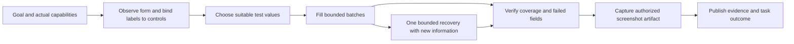

<!-- Generated by spec-lite | workflow: focused run review and planning | date: 2026-10-13 -->

# Plan: Reliable completion of `yantra do` tasks

**Status:** Proposed; no implementation performed.
**Trigger:** Run `20261014T023539Z-do-7039cbaa`.
**Evidence:** [Focused review](reviews/review_do_workflow_run_20261014.md).

## Diagnosis

The request was to fill suitable test data into every field at the supplied test-form URL, then take a screenshot without submitting. This is a reasonable medium-complexity browser task: the initial observation exposed 40 controls, including six selects. It should be feasible with reliable field identification, bounded batch fills, correct verification, and an available capture capability.

The observed failure was a chain of missing information and misleading feedback, followed by time exhaustion:

1. All 40 controls reached the model with empty names. Page text contained field labels, but no trustworthy connection between each label and an actionable ref. The agent spent many turns trying to reconstruct that connection.
2. Its name-based fill failed, with suggestions dominated by navigation links. It then guessed ref-to-label mappings, fetched already-known page text, listed an empty workflow catalog, and tried a rejected `view-source:` navigation.
3. A masked control reported `WIDGET_NOT_COMMITTED` despite `value_present: true`. Current code has a mechanism that can produce this contradiction: typing verifies raw input, while later committed-value verification returns an empty string for protected controls. The historical control's actual identity remains unproven.
4. Ordinary text fills took about five seconds each, including a suggestion-discovery wait. The first ten-field batch took 56.45 seconds.
5. No screenshot tool was available. The current screenshot tool is gated as provider vision assistance, requiring both a stored grant and an image-capable model. The run does not record which gate prevented registration.
6. The 12-minute exploration boundary was crossed. The model correctly published an incomplete result, but the runtime classified publication as task completion.

**Measured:** 13m 04s elapsed; 15 tool calls; approximately 69s in recorded tools; 52,219 output tokens, of which the session identifies 50,564 as reasoning. Roughly 11m 55s was outside recorded tool execution. That remainder includes provider work and orchestration overhead; it is not a separately measured provider latency. `usage.json` turn latency already includes tool execution, so these durations must not be added together.

Ten controls were reported successfully committed, one attempted control failed verification, and 29 controls were not attempted. The successful commits do **not** establish that the agent chose the right field labels. No capture exists. Navigation, host, and provider-token ceilings were not exhausted. The soft wall-clock boundary is intentional publication headroom and should remain.

## Intended behavior

For an ordinary static form, the model should choose values and a small number of actions. The engine should supply field identities, resolve and verify controls, account for progress, and persist the requested capture. If mapping or capture is unavailable, disclose that specific blocker early. A saved partial report remains useful, but task success must mean the requested work was fulfilled.

## Delivery sequence

Each item is a vertical slice: behavior, meaningful tests, artifact compatibility, and relevant user documentation. IDs below are planning labels, not allocated FEAT IDs.

| Order | Slice                                             | Type                            | Main result                                                                           |
| ----- | ------------------------------------------------- | ------------------------------- | ------------------------------------------------------------------------------------- |
| 1     | DO-01: Honest task outcome                        | Fix                             | A published partial result cannot masquerade as successful execution                  |
| 2     | DO-02: Form identity and inventory                | Feature plus error-feedback fix | Every resolvable field has a supported semantic identity; ambiguous ones are explicit |
| 3     | DO-03: Protected-value verification               | Fix                             | Privacy masking cannot be mistaken for failed input commitment                        |
| 4     | DO-04: Plain-field performance and batch clarity  | Performance fix                 | Stable text inputs avoid the long autocomplete wait; batches have clear limits        |
| 5     | DO-05: Screenshot deliverables and capability fit | Feature                         | An authorized local capture can be delivered by a text-only agent                     |
| 6     | DO-06: Progress-aware execution                   | Runtime enhancement             | Reads and reasoning cannot consume the run indefinitely without advancing the task    |
| 7     | DO-07: Action evidence and completion benchmark   | Feature and validation          | Reports cite actual action outcomes, and tests verify the entire requested task       |

Start the representative fixture and baseline measurements alongside DO-01. Extend that fixture with each subsequent slice. DO-06 depends on the form inventory and verified action outcomes; DO-07 closes the end-to-end acceptance gate. DO-05 can proceed independently after the task-outcome vocabulary is agreed.

### DO-01: Preserve publication, classify fulfillment separately

**Change:** Keep the terminal publication exemption. Introduce a runtime-derived task outcome alongside publication state: fulfilled, partial, blocked, or failed. Record the termination reason separately, including exploration-budget exhaustion. Publication success is a saved artifact, not sufficient evidence of task success.

For `do`, reconcile the declared requirements, explicit unmet items, constraint violations, and available action/capture evidence. `fulfillment.met` from the model is an input to validate, not an authority. A model must not be able to omit a known failed field or required capture and obtain a fulfilled outcome. Contract revisions must not silently erase an already established requirement.

Preserve existing manifest enums where practical by adding task-outcome fields and using existing failure classifications for unfulfilled execution. Document and test the CLI exit-code choice against the standing contract: 0 for fulfilled execution, 2 for unfulfilled execution, 4 for a real user handoff. Do not globally reinterpret all partial research answers as execution failures; command-specific criteria are required.

Update manifest, events, report, terminal/JSON output, and workflow promotion consistently. Incomplete runs can still retain Brief artifacts. Successful workflow promotion must not be inferred merely from publication.

**Likely files:** `packages/agent/src/runtime/orchestrator.ts`, `contract-delivery.ts`, `brief-composer.ts`; protocol run/event schemas; `apps/cli/src/connector-io.ts` and command consumers.

**Acceptance:** This historical result is classified partial, with a saved Brief and `wall-clock-soft` reason, rather than fulfilled. A complete form with the requested capture succeeds. Missing evidence cannot become success by changing a model-authored boolean. Existing run artifacts remain readable.

### DO-02: Give the agent a trustworthy form inventory

**Change:** Extend the existing observation/fill surface with bounded form metadata. Include semantic label, label origin/confidence, control kind and input type, form/section context, required/disabled state, constraints such as maxlength/pattern where useful, and offered select labels. Distinguish the real accessible name from an inferred visual label.

Resolve labels in a shared core component: explicit associations first, then conservative structural context such as a containing form row, adjacent label cell, or clearly bounded field wrapper. Use geometry only as bounded supporting evidence. Never infer the entire mapping by zipping extracted page text with ref order. Never key behavior to a website or brand.

Use the same identities for observation, name resolution, fill reacquisition, replay where applicable, and action evidence. Keep refs opaque and page-scoped; the numeric suffix does not encode DOM order. A reordered or replaced unnamed control must not inherit a previous field's intent without verification.

Handle forms larger than the model-visible cap through scoped inventory/pagination or explicit continuation. Report total eligible controls and omitted counts; do not silently declare the visible subset to be the whole form.

Correct not-found feedback to offer fillable controls rather than links. For unnamed fields, return usable refs and contextual labels through the model-visible result, not only hidden `details`. When structural evidence cannot separate two controls, return ambiguity with the actual candidates and the supported next diagnostic.

**Likely files:** `packages/core/src/discovery/interactable-scan.ts`, `discovery/observe.ts`, `browser/agent-controller.ts`, `interaction/resolution.ts`; agent `form-field-resolve.ts`, `browser-common.ts`, and fill wrappers.

**Acceptance:** Generic 40-control fixtures with weak or missing label associations can be addressed correctly without ordinal guessing. Duplicate labels, unrelated nearby text, CSS-reordered fields, dynamic replacements, and open shadow roots either resolve with evidence or return explicit ambiguity. Observation remains read-only and bounded.

### DO-03: Verify protected controls without exposing their contents

**Change:** Separate internal commitment checking from model-visible value disclosure. A masked or withheld value must have a typed state rather than being represented internally as an ordinary empty string.

For caller-supplied test data, verify the requested value at the browser execution boundary and return a safe match/commitment verdict with the field identity. For opaque stored secrets, retain existing confirmation, host binding, masking, and secret-latch behavior. Do not expose a raw value or reusable hash as evidence. Value presence alone is not proof of an exact match.

Classify failures according to what was observed: withheld readback, rejected value, wrong target, or verified loss after release. The current release-loss wording should require evidence that release actually occurred and lost a value.

**Likely files:** `packages/core/src/widgets/verify.ts`, `interaction/typing.ts`, `fill/engine.ts`, `fill/types.ts`; agent fill-result projections and failure messages.

**Acceptance:** Password-type and sensitive-autocomplete fixtures containing synthetic caller data do not falsely fail after successful entry. Rejected or truncated values still fail. Stored-secret canaries remain absent from model payloads, logs, and captures. The fix covers both agent interaction and deterministic replay paths without merging their different actionability contracts.

### DO-04: Make simple fills inexpensive and batches explicit

**Change:** Add an evidence-gated fast path for ordinary inputs. When the control commits the value and shows no suggestion/popup behavior, use a short bounded reaction check and normal verification. Keep the existing longer settling policy for declared or observed autocomplete behavior, and a bounded escalation when a supposedly plain field reveals a popup. Preserve late-suggestion regression coverage.

Align the prompt and schema immediately: the existing cap is ten fields per call, so describe bounded batches and how to continue. Do not simply raise `maxItems` to 40 while each field still costs about five seconds: that can exceed the current 180-second tool timeout. A later larger-batch interface should partition work inside the engine, honor the shared deadline, preserve widget groups, and account for every applied/failed/unattempted field.

Keep full recovery ledgers in the audit artifact. Return compact success summaries to the model; expose detailed recovery on the fields that failed or actually needed escalation. Offer already-verified progress and remaining counts so another observation is unnecessary after each batch.

**Likely files:** `packages/core/src/fill/engine.ts`, `widgets/combobox/combobox-driver.ts`; agent `browser-fill-form.ts`, `browser-fill-element.ts`, `runtime/profiles.ts`, and audit projections.

**Acceptance:** A static plain input does not pay the full four-second suggestion wait. Initial performance target: 40 controls filled and verified within 60 seconds of browser/tool time on a controlled local fixture; calibrate this target from measured baseline, not a CI wall-clock guess. Late suggestions, masked inputs, and date-range groups remain correct. No committed field is resent because another field failed.

### DO-05: Treat the requested screenshot as a deliverable

**Change:** Separate local artifact capture from sending pixels to a model. Preserve the explicit stored screenshot grant and sensitive-screen protections; provider image support should govern provider vision input, not whether an authorized local PNG can be saved. A model-authored contract grants no permission.

Resolve and persist actual capabilities before execution, including distinct availability/reason codes for local capture and provider vision. Tell the agent the concrete limitation. If required capture lacks authorization, disclose the setup requirement before spending the run on filling. If some useful work is allowed, report its outcome precisely; never silently promise a capture that the catalog cannot provide.

Add a deliverable capture path appropriate to the whole form, with clear viewport/full-page/section semantics and bounded bytes/pixels. A clean output screenshot should not automatically inherit the numbered marks intended for model vision assistance. If the full form needs multiple bounded captures, label the scope and return an explicit artifact set. Persist paths and hashes and surface a clickable artifact in the result.

**Likely files:** `packages/agent/src/runtime/vision.ts`, `runtime/orchestrator.ts`, tool factory and `browser-screenshot.ts`; `packages/core/src/browser/agent-controller.ts`; capture schemas and result rendering.

**Acceptance:** With the appropriate stored grant, a text-only provider fills the test form and saves the requested screenshot without sending pixels to that provider. Without the grant, startup explains the blocker. Vision assistance retains its existing five-condition gate. Real secret-latched screens remain protected; no grant is silently enabled.

### DO-06: Track task progress, not just tool errors

**Change:** Maintain a small runtime progress ledger using the inventory and verified outcomes: identified, committed, failed, unresolved, and remaining controls; required artifacts; and elapsed budget. This augments Yantra's policy layer while Pi retains ownership of the agent loop.

A successful read is not necessarily progress. Repeated observations/extractions of unchanged evidence, an empty workflow listing, and unsuccessful source-view exploration must not reset task progress. Evaluate stall checkpoints at provider/tool boundaries using semantic changes rather than tool name alone. Allow legitimate verification and dependency work; do not terminate solely because an observation is unchanged.

After a bounded stall, steer once to the supported next action with the latest progress and deadline. If no safe action can resolve the blocker, publish a precise partial/blocked result. A long provider turn still needs a supported adapter timeout/abort path; a tool-boundary counter alone cannot bound reasoning within a turn. Verify the SDK capabilities before designing a recovery mechanism, and do not introduce a second agent loop or another top-level provider session.

Expose exploration time remaining separately from publication headroom. Reserve enough capacity for required final verification/capture before exploration consumes it. Add per-turn reasoning-token and duration telemetry without persisting raw thought text into stable run summaries.

Benchmark reasoning levels only after the metadata and verification fixes. Honor an explicit user's `--thinking` or stored preference. Any future task-aware default must apply only when no explicit override exists. This single high-thinking run cannot establish that another provider or reasoning level is the complete solution.

**Likely files:** agent runtime orchestration, budget, services and recorder; Pi adapter event/abort seam; prompt/profile metadata.

**Acceptance:** Repeated unchanged reads and successful empty catalog calls do not hide a stall. A supported provider-time limit bounds a long reasoning turn. A useful partial fill advances progress despite a field failure. Real autocomplete settling and required verification remain allowed. The agent gets one concrete recovery and then terminates honestly when no supported path remains.

### DO-07: Attribute actions and test the whole task

**Change:** Add sanitized action/capture evidence linked to tool call, document epoch, resolved field identity, and verification verdict. Keep document-source evidence separate: pre-fill page text cannot establish that `John` was later committed to a particular field. Teach publishing/anchoring how to cite action observations without weakening existing source checks. An inferred field identity must remain visibly inferred.

Extend the existing task-fidelity harness with browser mutation scenarios. The current catalog focuses on extraction, research, contracts, and publication, and has no equivalent all-fields-plus-capture scenario. Reuse the existing browser gauntlet and fixture infrastructure rather than building another harness.

Use deterministic scripted-provider scenarios to prove engine behavior and runtime outcome handling. Then run a separate live-provider benchmark to prove that the model can choose and sequence those capabilities; a scripted agent cannot demonstrate autonomous task completion.

**Required scenarios:**

- Forty controls with a mix of explicit and structural labels, native selects, textarea, and synthetic protected values.
- CSS visual order differing from DOM order; duplicated labels; insufficient contextual evidence; form inventory exceeding observation caps.
- One failed field, one dynamic replacement, and a date range committed as a pair: preserve successful work and retry only the affected group.
- Text-only model with capture grant; missing grant; secret-latched screen; requested capture outside the viewport.
- Soft-budget exhaustion after partial fill; model publishes `met: true` contrary to observed gaps; model omits fulfillment entirely.
- Verified action values absent from the pre-fill document: cite action evidence without spurious page-source anchoring notices.

**Acceptance gate:** Final browser values match the intended controls, all required eligible controls are accounted for, submission handler count is zero, a valid PNG covers the declared scope, the artifact is linked, and runtime/CLI task outcomes agree with fulfillment. Privacy and deterministic replay tests remain green.

**Initial live benchmark target:** At least 19 successful completions in 20 runs of the representative medium-complexity form task, within five minutes per run, including capture. Record median/p95 elapsed time, tool time, reasoning tokens, correct field coverage, retries, captures, and true task-success rate. Compare against the same model/settings first. These are proposed acceptance targets, not achieved measurements.

## Rollout and limits

Use additive artifact/schema fields wherever possible; test old runs without the new fields. Existing workflow YAML remains compatible. Exercise both agent tools and replay for changed core semantics. Run targeted behavior suites from their package directories, rebuild core before trusting agent/CLI/e2e consumers, then run the project-required lint, typecheck, and integration gates during implementation. No tests or live task reruns were needed to author this plan.

Keep the existing browser, extraction cache, URL provenance, consent, secret masking, and soft/hard deadlines. None of the proposed improvements needs unrestricted scripts, raw-HTML export, a `view-source:` bypass, site-specific logic, larger global budgets, or a replacement agent SDK. Existing source acquisition already avoided a duplicate network fetch; that behavior should remain.

Persist build/source revision, effective relevant budgets, capture gate reasons, and task-progress summary in future run artifacts. The historical manifest records SDK/model/prompt provenance but not the Yantra source revision, so current-source explanations cannot prove the exact deployed build.

The primary implementation risk is incorrect inferred labels: conservative ambiguity is preferable to putting data in the wrong control. The other key regressions to prevent are late autocomplete truncation, protected-value leakage, and changing partial research behavior through a global publication-status rewrite. Each has explicit tests above.

**Recommended first milestone:** DO-01 through DO-04, plus the authorized local-capture path in DO-05. Demonstrate one correctly filled 40-control fixture with a saved screenshot and truthful task status before adding broader adaptive execution policy.
